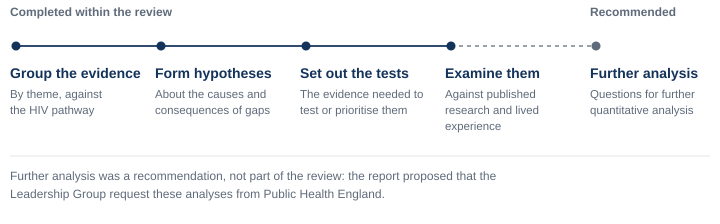
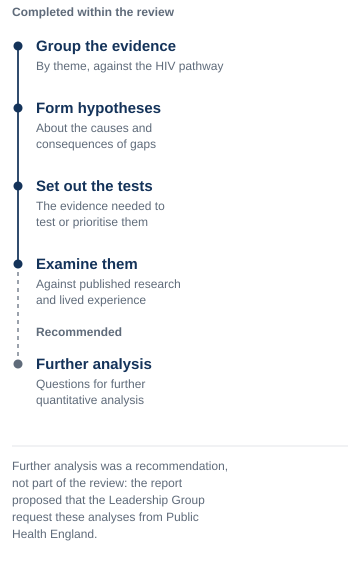
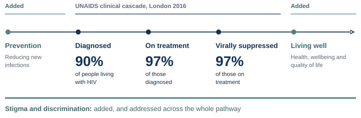
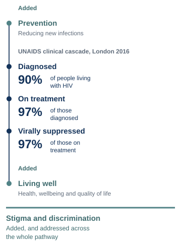

<!-- meta
description: Pathway Analytics led the London-wide Asset and Gap Analysis, bringing together evidence from clinicians, commissioners, community organisations and people living with HIV to inform the city's strategic direction.
-->

Strategy

# Fast-Track Cities London: Shaping the strategy to get to zero

Fast-Track Cities London · June to November 2018

On 10 January 2018 the Mayor of London, London Councils, NHS England and Public Health England signed the Paris Declaration on Fast-Track Cities. London had already met the United Nations' 90–90–90 HIV targets. The challenge was how to build on that success to end new HIV infections, prevent HIV-related deaths, eliminate stigma and improve the lives of people living with HIV. Pathway Analytics led the London-wide Asset and Gap Analysis, bringing together evidence from clinicians, commissioners, community organisations and people living with HIV to inform the city's strategic direction.

  
<b>120+</b>stakeholders consulted

  
<b>80+</b>stakeholders interviewed

  
<b>24</b>participants in lived-experience workshops

  <dl>
    <dt>Client</dt><dd>Fast-Track Cities London, on behalf of the Mayor of London, London Councils, NHS England and Public Health England</dd>
    <dt>Period</dt><dd>June to November 2018</dd>
    <dt>Role</dt><dd>Lead consultancy for the London-wide Asset and Gap Analysis: stakeholder workshops, interviews and surveys, evidence synthesis and the final report</dd>
    <dt>Project lead</dt><dd>Bella Grant, Director, Pathway Analytics</dd>
    <dt>Capabilities</dt><dd>System strategy · stakeholder engagement · commissioning analysis</dd>
  </dl>

<nav class="cs-contents" aria-label="On this page">
  <a href="/case-studies/fast-track-cities-london?id=the-challenge">The challenge</a>
  <a href="/case-studies/fast-track-cities-london?id=our-approach">Our approach</a>
  <a href="/case-studies/fast-track-cities-london?id=leadership-and-influence">Leadership and influence</a>
  <a href="/case-studies/fast-track-cities-london?id=what-the-review-delivered">What the review delivered</a>
  <a href="/case-studies/fast-track-cities-london?id=impact-and-legacy">Impact and legacy</a>
</nav>

## The challenge

London first met the UNAIDS 90–90–90 targets in 2016: 90% of people living with HIV had been diagnosed, 97% of those diagnosed were receiving treatment and 97% of those receiving treatment were virally suppressed.

These clinical measures did not capture the full range of challenges facing London. Progress towards zero depended on reaching people whom existing services were not reaching, addressing stigma and supporting people to live well with HIV. Responsibility for these activities was dispersed across the NHS, local government, public health bodies and the voluntary sector.

The Leadership Group needed a picture of what was already working across London, where gaps remained and what could be done differently.

## Our approach

**Start with what works.** The review examined London's existing assets as well as gaps, recognising the expertise, relationships and support already provided by clinical teams, community organisations, volunteers and people living with HIV.

Bella Grant led the commission and the overarching stakeholder workshops. At the stakeholder event on 13 July 2018, participants first recorded their views individually, then discussed them in groups, identifying examples and sources of further evidence. The assets and gaps session generated 317 assets and 298 gaps for further exploration.

The wider research engaged more than 120 stakeholders through workshops, interviews and surveys, supported by literature reviews. Interviews with more than 80 stakeholders provided much of the detailed qualitative evidence.

**Hear from people whose experiences might otherwise be missed.** Two dedicated *Unheard Voices* workshops involved 24 people living with HIV. The Unheard Voices workshops formed a distinct component of the qualitative research, using a methodology developed by Partners in Creation. Pathway Analytics supported this work and incorporated its findings into the wider strategic assessment. Participants shared experiences of care and support across specialist services, primary care, housing, employment and their communities.

Items raised for further exploration, not validated findings. Participant counts overlap. Figures from Pathway Analytics' workshop materials and the 2018 Asset and Gap Analysis report.

## Leadership and influence

**Adapting the method.** The original plan included investigative quantitative analysis to test the emerging findings. The timing of new surveillance data and restrictions on access to underlying HIV and sexual health datasets meant that this analysis could not be completed within the review.

The team revised its synthesis process. Rather than present stakeholder views as established facts, it grouped the evidence by theme against the HIV pathway, developed hypotheses about the causes and consequences of significant gaps, set out the evidence needed to test or prioritise them, and examined them against published research and lived-experience evidence.

The final report identified questions requiring further quantitative investigation and recommended that the Leadership Group request the relevant analyses from Public Health England. It distinguished what the review could establish from what needed further examination.

Based on the synthesis process in the 2018 Asset and Gap Analysis report.

## What the review delivered

**Beyond the clinical cascade.** Pathway Analytics extended the conventional HIV care cascade to include prevention, living well, and stigma and discrimination, making the wider 2030 ambitions explicit across the pathway.

London's figures are for 2016, and each percentage is of the stage before. UNAIDS set the 90–90–90 targets for 2020. Figures from the Mayor of London's announcement, 10 January 2018.

**Who was responsible for what?** Detailed commissioning matrices mapped prevention, testing, and treatment and care against the organisations responsible for funding them in 2018. They showed how individual interventions could have different funding arrangements depending on where, why and by whom they were delivered, and highlighted areas where funding was unclear or absent. This made visible what a shared city-wide ambition would mean for each organisation.

Source: Pathway Analytics, London Fast-Track Cities Asset and Gap Analysis, 2018, pp. 42–45. Historical commissioning and funding arrangements.

**Four themes for further consideration.** The review identified four recurring themes:

- Address HIV-related stigma and discrimination beyond specialist clinical settings.
- Tailor prevention and testing to communities not adequately reached by existing services, and strengthen routes into and back into care.
- Support people to live well with HIV, including through better coordination with primary care, mental health and wider support services.
- Improve coordination and accountability across commissioning bodies and build on the expertise already present in London's HIV community.

## Impact and legacy

**Delivered.** Emerging findings presented to the inaugural Fast-Track Cities Leadership Group in September 2018, and the final Asset and Gap Analysis report in autumn 2018.

**Recognised.** Fast-Track Cities London's [account of the July 2018 stakeholder event](https://fasttrackcities.london/londoners-pledge-to-eradicate-hiv-and-the-harm-of-its-stigma/) names Bella Grant of Pathway Analytics, who introduced the assets and gaps project. Its [history of the programme](https://fasttrackcities.london/about-us/journey-to-fast-track-cities/) records that the Leadership Group based its priority areas on stakeholder engagement and an asset and gap analysis.

**Taken forward by the Leadership Group.** The priority areas are set out in the Leadership Group's 2019 [Roadmap to Zero](https://fasttrackcities.london/about-us/roadmap-to-zero/), in four areas: leading across boundaries, advocating for London, delivering together, and communicating and engaging.

**Related on this site**

This commission built on Pathway Analytics' experience of London's HIV system, including its 2013 and 2016 to 2017 reviews of specialist HIV services for NHS England, which examined workforce capacity, service reconfiguration and funding.

- [Who should pay for sexual assault services?](/case-studies/sexual-assault-services)
- [Redesigning the funding of sexual health services in England](/case-studies/sexual-health-tariff)

**Published evidence**

- Mayor of London, [*London joins Fast-Track Cities initiative to reduce new HIV infections*](https://www.london.gov.uk/press-releases/mayoral/london-joins-hiv-fast-track-cities-initiative), 10 January 2018
- Fast-Track Cities London, [*Londoners pledge to eradicate HIV and the harm of its stigma*](https://fasttrackcities.london/londoners-pledge-to-eradicate-hiv-and-the-harm-of-its-stigma/), 31 July 2018
- Fast-Track Cities London, [*Journey to Fast-Track Cities*](https://fasttrackcities.london/about-us/journey-to-fast-track-cities/)
- Fast-Track Cities London, [*Roadmap to Zero*](https://fasttrackcities.london/about-us/roadmap-to-zero/)

