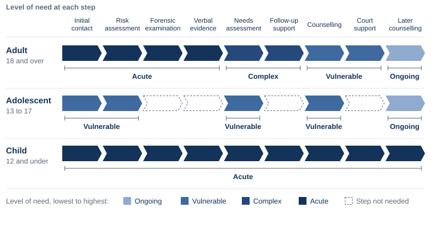
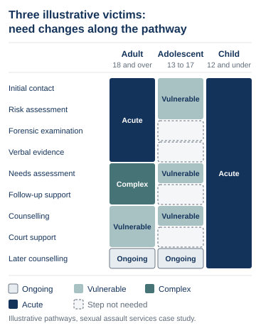
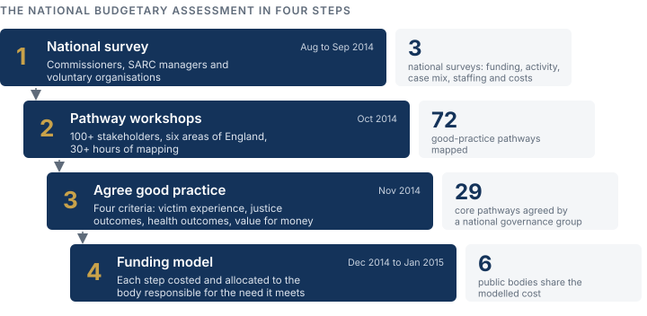
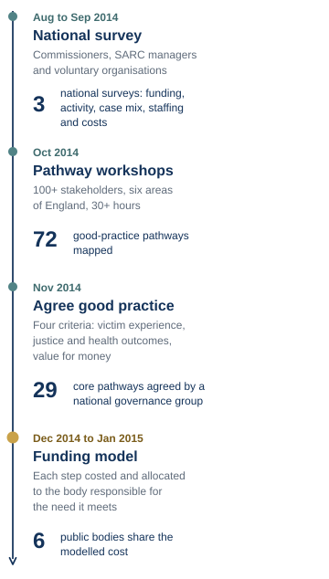
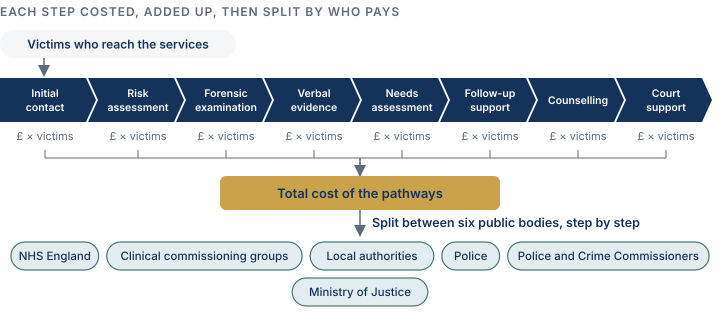
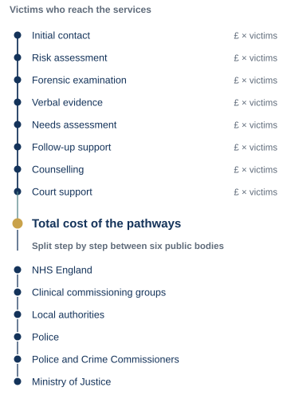
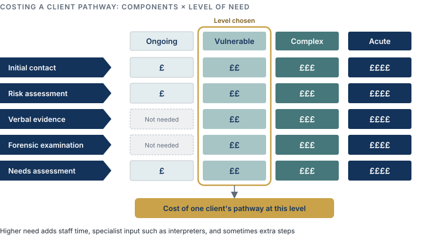
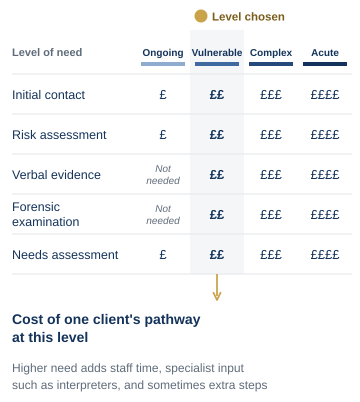
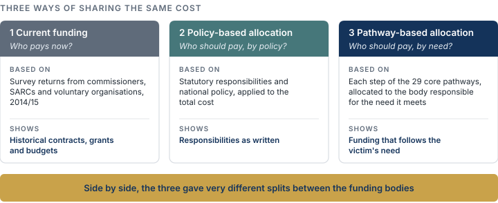
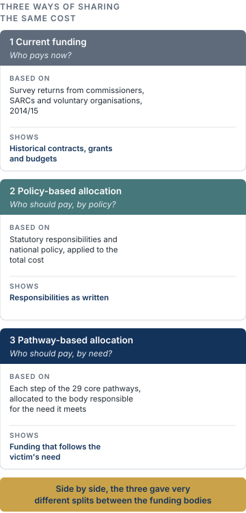

<!-- meta
description: How Pathway Analytics built a national framework for costing sexual assault services and sharing the cost across health, policing, justice and local government.
image: /assets/images/og/sexual-assault-services.png
image_alt: Case study: Who should pay for sexual assault services? From a four-site pilot in 2012 to a proposed funding allocation in 2015.
-->

Strategy · Health Economics

# Who should pay for sexual assault services?

National SARC Subgroup on Pathway Costing, then NHS England with the Home Office and the Ministry of Justice · 2012 to 2015

Between 2012 and 2015 Pathway Analytics led two linked national commissions on a problem no single body owned: how to organise and pay for care for victims of sexual assault when responsibility is split between health, policing, criminal justice, local government and the voluntary sector. The work agreed what good practice looks like, built an economic model that reflects each victim's level of need, and proposed how the cost should be shared. The principle was that funding should follow need, not historical budgets and organisational boundaries.

Illustrative scenarios, not typical pathways for each age group.

<b>29</b>core pathways agreed, from 72 mapped with stakeholders

<b>43</b>Sexual Assault Referral Centres, with 100+ voluntary organisations surveyed

<b>70%+</b>of the modelled cost of good-practice care is advocacy and talking therapies

<dl>
<dt>Client</dt><dd>National SARC Subgroup on Pathway Costing (2012); NHS England, for its programme board with the Home Office and the Ministry of Justice (2014 to 2015)</dd>
<dt>Period</dt><dd>2012 to 2015</dd>
<dt>Role</dt><dd>Lead consultancy for a four-site pilot review and the national budgetary assessment that followed it, co-authored with NHS England's national programme manager</dd>
<dt>Capabilities</dt><dd>Multi-agency strategy · pathway design with stakeholders · economic modelling · funding allocation · national governance</dd>
</dl>

<nav class="cs-contents" aria-label="On this page">
<a href="/case-studies/sexual-assault-services?id=the-challenge">The challenge</a>
<a href="/case-studies/sexual-assault-services?id=our-approach">Our approach</a>
<a href="/case-studies/sexual-assault-services?id=leadership-and-influence">Leadership and influence</a>
<a href="/case-studies/sexual-assault-services?id=the-solution">The solution</a>
<a href="/case-studies/sexual-assault-services?id=what-the-economics-revealed">What the economics revealed</a>
<a href="/case-studies/sexual-assault-services?id=impact-and-legacy">Impact and legacy</a>
</nav>

## The challenge

A victim of sexual assault may need a forensic examination, medical care, an independent advocate, support through court and therapy for years afterwards. By 2014 that pathway crossed seven public bodies: police forces, Police and Crime Commissioners, NHS England, clinical commissioning groups, local authorities, the Home Office and the Ministry of Justice. Each paid for part of it, and none could see the whole.

Services had grown up locally in very different shapes, from a rural service examining about 50 victims a year to a London one-stop service examining about 650. Commissioning areas followed county lines, while Sexual Assault Referral Centres (SARCs) followed police force boundaries. Much of the long-term support came from voluntary organisations, largely out of sight of the main health commissioner, and much of the spend sat inside other contracts.

There was no common definition of need, activity or good practice. Without one, nobody could say what a good service cost, and every conversation about funding became a negotiation between budgets.

## Our approach

The work started from what victims need at each step and what practitioners do to meet it, and built the economics and the funding question up from there. It ran in two stages.

**A four-site pilot, 2012.** The first review ran for two months at four SARCs. They tracked 150 pathways delivered to 112 clients over two weeks, so costs came from what staff did rather than from routine returns. The sites also agreed common client definitions: acute, historic and advice only.

**A national budgetary assessment, 2014 to 2015.** NHS England commissioned the second stage to build on the first, extending it to adolescents, children and long-term therapeutic care. It ran in four steps.

Figures and dates from the 2015 national budgetary assessment.

**Every hidden cost counted.** Police evidence kits, pathology, sample storage, volunteer time, free premises and forensic contracts buried in custody contracts were all brought into the figures.

## Leadership and influence

The organisations involved had different statutory duties, budgets, boundaries and priorities. Starting from funding shares would have meant starting from budgets, so the process agreed what good practice looked like before anyone discussed who should pay.

**Good practice first.** More than 100 stakeholders, drawn from SARCs, voluntary organisations, the police and commissioners, mapped 72 good-practice pathways in workshops across six areas of England. In November 2014 a national governance group assessed them against four agreed criteria: victim experience, justice outcomes, health outcomes and value for money. It distilled them into 29 core pathways.

**Commissioners across the country.** The national surveys went to the commissioners in all ten NHS England area teams, to every SARC and, through their umbrella bodies, to voluntary organisations. The team also worked with Police and Crime Commissioners and officials from several government departments.

**Funding discussed step by step.** The proposed allocation looked at each step of each pathway and asked which body is responsible for the need it meets. Working at that level keeps the discussion on what each activity achieves for the victim, and avoids the deadlock that comes from negotiating over whole budgets.

A proposed allocation, not an agreed settlement.

## The solution

The assessment gave commissioners an agreed set of pathways and the tools to cost them and share the cost.

- **A whole-pathway framework.** 29 core pathways in six components: initial contact, advice and support, evidence collection, follow-up support, advocacy and talking therapies. SARCs and voluntary organisations are in one picture.
- **A pathway costing model.** Each step is costed for adults, adolescents and children at four levels of need. Commissioners can use its dashboard to test the choices that drive cost: nurse-led or doctor-led examination, in-hours or out-of-hours cover, how many forensic samples are tested, how often therapy sessions run, and volunteers or paid staff.
- **A case-mix model** that scales individual pathways up to a national picture of demand and cost.
- **A proposed commissioning matrix** showing which body should fund each step.

Relative costs only, illustrative.

## What the economics revealed

**Most of the cost comes after the examination.** In the model, advocacy and talking therapies made up more than 70% of the cost of good-practice care, most of it delivered by voluntary organisations. Evidence collection, the part of the service built around the forensic examination, was about 10%. These are modelled costs at 2014/15 prices, not current spending.

**So who should lead?** The report asked whether NHS England should remain the lead commissioner when most of the cost lay in therapeutic support, and recommended a bigger role for clinical commissioning groups and local authorities.

**Current provision fell short of good practice.** Services were spending less than the model said good practice would cost, and the report judged current spending to be under-reported, with costs hidden in other budgets.

Illustrative: no proportions shown.

**Three ways of sharing the cost.** The team compared who pays now, who should pay under current policy, and who should pay according to the need each step meets. The three gave very different splits. The pathway-based view put the largest share on clinical commissioning groups, which commission talking therapies. The choice between them lay with the programme board.

**What drives cost.** Two things: the level of a victim's need, and how forensic examination contracts are let. At the four pilot SARCs, the SARC part of an adult's pathway cost about £2,000 per acute client on average, with the differences between sites coming mainly from forensic contracts. Across the whole pathway, the modelled cost of supporting an adult victim of rape rose from £8,520 at the vulnerable level to £39,281 at the acute level.

**Volunteers.** In the 48 voluntary agencies that returned full surveys, volunteers made up 21% of staff time, lower than is commonly assumed.

## Impact and legacy

**Delivered.** A four-site pilot review and a national budgetary assessment, a whole-pathway framework, a pathway costing model, a case-mix model and a proposed funding allocation.

**Agreed.** A national governance group agreed 29 core good-practice pathways against four criteria.

**Handed over.** The pathway costing model was handed over to NHS England.

**Recognised.** NHS England's June 2013 operating model for commissioning sexual assault services cites the SARC costing model with Pathway Analytics, in its account of early work on costing SARC care pathways and who funds what.

**Related on this site**

- [Redesigning the funding of sexual health services in England](/case-studies/sexual-health-tariff)
- [Health Economics Toolkit](/healthcare-economics-toolkit/)
- [What is health economics for?](/insights/what-is-health-economics-for)

**Published evidence**

- NHS England, *Securing excellence in commissioning sexual assault services for people who experience sexual violence*, June 2013, page 7 and footnote 9

