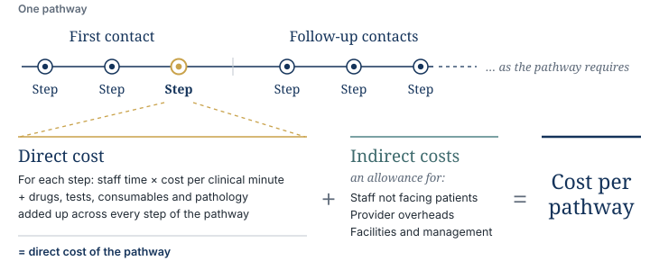
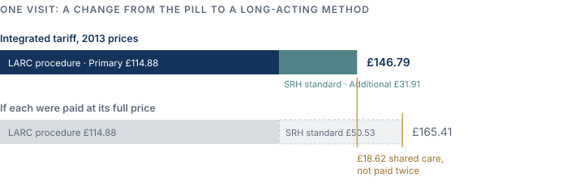
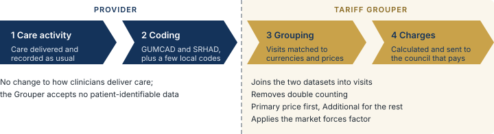

<!-- meta
description: How Pathway Analytics redesigned the funding of sexual health services, from clinical pathways and financial impact modelling to a tariff and digital service still in use across England.
-->

Strategy · Health Economics · Digital Solutions

# Redesigning the funding of sexual health services in England

London Sexual Health Programme, then councils and providers across England · 2009 to present

A tariff built from clinical pathways, agreed with clinicians and commissioners, that pays fairly for integrated sexual health care. The digital service that runs it has been in use since 2011.

  
<b>140+</b>clinical pathways costed with clinicians

  
<b>17</b>currencies, each with a Primary and an Additional price

  
<b>130</b>services in England commissioned solely on the tariff in 2025/26

  <dl>
    <dt>Client</dt><dd>London Sexual Health Programme; then councils and providers across England</dd>
    <dt>Period</dt><dd>2009 to present</dd>
    <dt>Role</dt><dd>Lead consultancy: tariff design, financial impact assessment, Grouper development and operation</dd>
    <dt>Capabilities</dt><dd>Commissioning reform · clinical pathway costing · payment design · financial impact modelling · digital implementation</dd>
  </dl>

## The challenge

By 2009 the way sexual health services were paid worked against the integrated care that clinicians and commissioners wanted to provide. Hospital genitourinary medicine (GUM) clinics were paid through the national Payment by Results tariff, at a first and a follow-up price per attendance. Contraception and reproductive health services were mostly funded through block contracts, set from projected activity rather than the care delivered.

The London Sexual Health Programme had three concerns. Reproductive health clinics were not adequately funded, and nor was much of the complex care in GUM clinics. The payment rules discouraged services from integrating. Commissioners received little information, and too late to inform their decisions.

Open access created a second problem. Anyone can attend any sexual health clinic, so the commissioner hosting a clinic paid for everyone it saw, wherever they lived. A fair system needed each commissioner to pay for its own residents, wherever they were treated.

A: local residents seen by local clinics. B: local residents seen by clinics elsewhere. C: visitors from elsewhere seen by local clinics. Redrawn from Pathway Analytics' regional road-test packs, 2013 to 2014.

No central body was prepared to mandate a new tariff, so reform had to be adopted locally, on its merits. From April 2013 most sexual health commissioning moved from the NHS to local authorities, so the solution also had to survive a change in who paid.

## Our approach

The approach combined clinical pathway design with health economics. The price was built up from the care itself, then tested against what the system was already spending. The London Sexual Health Programme set eight principles for the work. The tariff should:

1. promote the interests of patients and public health
2. keep open access services in place
3. encourage the integration of GUM and reproductive health services
4. offer value for money and affordability, without destabilising providers or commissioners
5. be robust and defensible
6. be based on clinical best-practice pathways
7. be independent of the setting in which care is given
8. keep the burden of information management to a minimum

**From pathway to price.** Clinicians mapped more than 140 good-practice pathways covering almost all GUM and contraception care. Each pathway was broken into its steps: who delivers each one, for how long, and with which drugs, tests and consumables. Staff time was costed per minute of clinical time, and other resources were costed from published sources such as the British National Formulary and national pay scales. An allowance for overheads was then added. Local cost adjustments were stripped out, so the same care carries the same price wherever it is delivered.

Every step of every pathway is costed the same way, from published sources, with local cost adjustments removed. Redrawn from Pathway Analytics' tariff background slides, 2011 to 2016.

**Tested from the top down.** The bottom-up pathway costs were checked against top-down reference prices and benchmarks. The method ran in six steps, from reference pricing through validation with pilot-site data to proposed currencies.

**From 140 pathways to 17 currencies.** A tariff with 140 prices would be unworkable. Patient-level data from 12 representative pilot sites across London was used to weight the pathways and group them into 17 currencies. Each currency is clinically meaningful and contains pathways of similar resource use.

**Fair payment for one-stop care.** Each currency has two prices. The Primary price is the cost of that care on its own. The Additional price is the marginal cost of delivering it alongside a more expensive currency in the same visit. A visit that meets several needs is paid for each of them, without paying twice for what they share.

The Additional price leaves out the care the two currencies share, such as registering the patient, so the visit is paid for both needs without paying twice. Worked example redrawn from Pathway Analytics' 2013 slides for London's reproductive health clinical leads; the patient is illustrative.

**Built on data clinics already report.** The tariff is triggered by the national GUMCAD and SRHAD returns, plus a small number of local codes (nine in 2013). About 85% of charges are triggered by data already in the statutory returns.

**Financial impact assessed before any money moved.** In each region the tariff first ran in shadow, alongside existing contracts. Its effect on every commissioner and provider was modelled, then stress-tested against changes in activity and case mix.

## Leadership and influence

The attendance tariff suited many hospital GUM services, so any change had to rest on evidence that clinicians and finance directors on all sides recognised as sound.

**Governance that brought the system together.** Four expert working groups were drawn from across London: clinical, commissioning, data management and finance. They reported to a steering group that included the Health Protection Agency, BASHH, the Faculty of Sexual and Reproductive Healthcare, and the Department of Health's Payment by Results team.

Roles only. Redrawn from the 2011 North West briefing pack and the 2013 summary description of the tariff.

**Clinical consensus.** Clinicians from GUM and contraception services built the pathways together, over hours of clinician time: wording to confirm. BASHH and the Faculty supported the resulting pathways. The prices therefore rested on care that clinicians recognised as their own.

**Financial scrutiny.** London's directors of finance reviewed the development process and accepted it as robust. London's financial impact assessment was overseen by a finance working group chaired by a director of finance.

**National recognition.** In September 2010 the Department of Health confirmed that a national tariff for integrated sexual health services would build on the London work, after PwC's evaluation of the first phase. In October 2010 it invited trusts to test the draft London tariffs, and named Pathway Analytics as their developer.

**Tested across England.** Road tests and shadow years with commissioners and providers ran in the North West (2011 to 2012), the South West (2012 to 2013), the East Midlands with Public Health England (2013 to 2014), Greater Manchester (2014) and Gateshead (2015 to 2016). By February 2013, eight regions had carried out financial and technical impact assessments.

**Through the move to local government.** After 2013 there was no central mandate, and each council decided for itself. The tariff and the Grouper met a new need: fair, transparent cross-charging between councils whose residents use each other's clinics. In 2014 to 2015, London's Directors of Public Health commissioned a borough-level refresh. It included scenarios testing how providers might respond, and options for phased introduction. London saving figure: awaiting clearance

## The solution

**The Integrated Sexual Health Tariff.** 17 currencies, each with a Primary and an Additional price, built from more than 140 clinical pathways. Prices are setting-independent, and any commissioner can use them to pay for its residents wherever they are seen. The pathways and prices are published, and a clinical working group reviews them each year, so the tariff can follow changes in clinical practice.

**The Tariff Grouper.** The Grouper takes a provider's routine activity data and turns it into charges for each responsible commissioner.

Redrawn from Pathway Analytics' tariff background slides, 2014 to 2016.

Each month, providers upload an extract of their GUMCAD and SRHAD returns. The Grouper joins the two datasets into single visits and applies the payment rules. It removes combinations that would count the same care twice. It pays the most expensive currency in each visit at its Primary price and the rest at their Additional prices, applies the provider's market forces factor, and allocates each charge to the responsible commissioner.

It holds no patient-identifiable data. Providers and commissioners work from the same data, so any dispute is about the activity, not the arithmetic. Subscriptions fund the service. It is available on the government's G-Cloud framework, for providers, for commissioners, and for councils setting their own local tariff rules.

## Impact and legacy

**Delivered.** More than 140 costed pathways, and 17 currencies with Primary and Additional prices. Financial impact assessments for London and for each region that road-tested the tariff. The Grouper, running since 2011.

**Implemented.** London providers have calculated tariff charges automatically and sent them to commissioners since 2011. By February 2013, more than 110 providers from every region had submitted data and calculated their charges: over 2.8 million individual tariffs, worth more than £200m. These figures measure activity processed, not savings.

**Adopted.** In 2017 London's commissioners and providers agreed a single standard tariff. DHSC's 2018 cross-charging guidance records it as the agreed basis for cross-charging within London. Councils outside London that pay on the tariff: names awaiting clearance The South East's 2020 regional cross-charging policy encourages integrated services to use the Pathway Analytics Grouper. In 2025/26, 130 services in England were commissioned solely on a Pathway Analytics tariff rather than on block contracts.

**Demonstrated impact.** Councils' own reports describe a fairer and more accurate way to pay for integrated care. Named council evidence: awaiting clearance In this way the tariff helped rebalance funding and incentives between GUM and reproductive health services. Council spending example: awaiting clearance

**Legacy.** Each year the tariff is reviewed and the Grouper updated. Public Health England's 2017 economic evaluation of PrEP in England cites the tariff among its references. Pathway Analytics sits on the BASHH and FSRH integrated sexual health information group.

**Related on this site**

- [Sexual Health Tariff Grouper](/sexual-health-tariff/)
- [Tariff pathways](/sexual-health-tariff/pathways)
- [Health Pathways](/health-pathways/)
- [Health Economics Toolkit](/healthcare-economics-toolkit/)

**Published evidence**

- Department of Health letters, September and October 2010 (Gateway 14766 and 15491)
- DHSC, sexual health cross-charging guidance, 2018
- [Tameside Council, Public Health Commissioning Intentions 2025/26, section 7.5](https://tameside.moderngov.co.uk/documents/s190657/ITEM%2018%20-%20PUBLICHEALTHCOMMISSIONINGINTENTIONS20252026FINALforfinancecomments.pdf)
- Pearce, Grant and Adams (2009), Phase 1 methodology, cited in *Sexually Transmitted Infections* 2011;87:464–468
- Ong et al., *Eurosurveillance* 2017;22(42)

