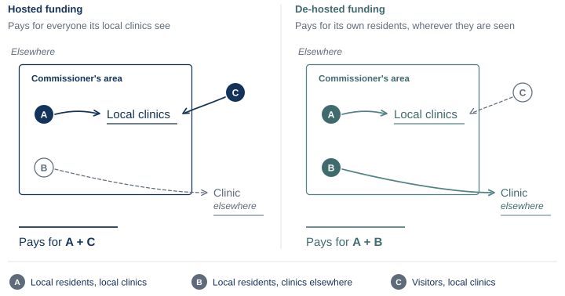
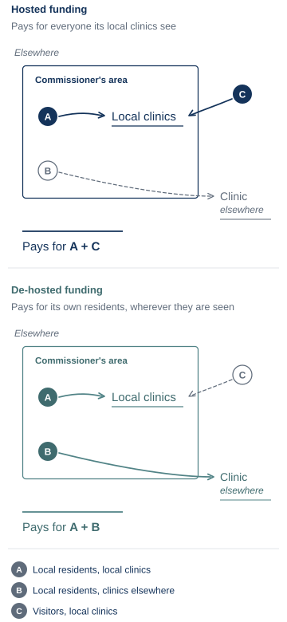
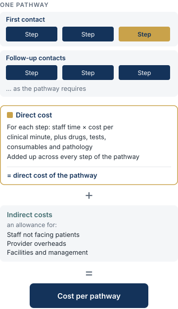
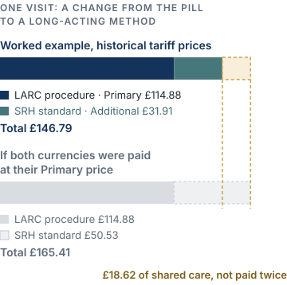
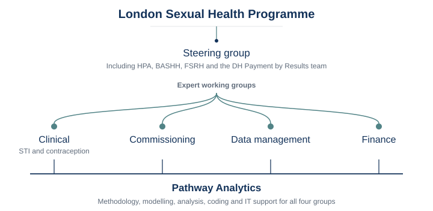
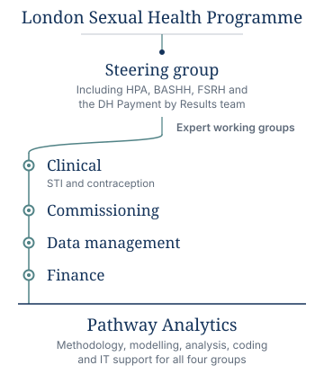
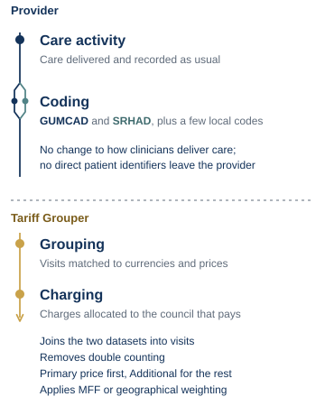

<!-- meta
description: How Pathway Analytics redesigned the funding of sexual health services, from clinical pathways and financial impact modelling to a tariff and digital service still in use across England.
image: /assets/images/og/sexual-health-tariff.png
image_alt: Case study: Redesigning the funding of sexual health services in England, with a timeline from design in 2009 to use in 2025/26.
-->

Strategy · Health Economics · Digital Solutions

# Redesigning the funding of sexual health services in England

London Sexual Health Programme, then councils and providers across England · 2009 to present

Pathway Analytics led the redesign of sexual health funding to address longstanding imbalances in funding and remove financial barriers to integrated, open-access care. Combining clinical pathway design, health economics and bespoke software development, the work established a new payment methodology that spread across England and remains in use today.

  
<b>140+</b>clinical pathways costed with clinicians

  
<b>17</b>currencies, each with a Primary and an Additional price

  
<b>130</b>services in England reported as commissioned solely on the tariff in 2025/26

  <dl>
    <dt>Client</dt><dd>London Sexual Health Programme; then councils and providers across England</dd>
    <dt>Period</dt><dd>2009 to present</dd>
    <dt>Role</dt><dd>Lead consultancy: tariff design, financial impact assessment, Grouper development and operation</dd>
    <dt>Capabilities</dt><dd>Commissioning reform · clinical pathway costing · payment design · financial impact modelling · digital implementation</dd>
  </dl>

<nav class="cs-contents" aria-label="On this page">
  <a href="/case-studies/sexual-health-tariff?id=the-challenge">The challenge</a>
  <a href="/case-studies/sexual-health-tariff?id=our-approach">Our approach</a>
  <a href="/case-studies/sexual-health-tariff?id=leadership-and-influence">Leadership and influence</a>
  <a href="/case-studies/sexual-health-tariff?id=the-solution">The solution</a>
  <a href="/case-studies/sexual-health-tariff?id=impact-and-legacy">Impact and legacy</a>
</nav>

## The challenge

By 2009 the way sexual health services were paid worked against the integrated care that clinicians and commissioners wanted to provide. Hospital genitourinary medicine (GUM) clinics were paid through the national Payment by Results tariff, at a first and a follow-up price per attendance. Contraception and reproductive health services were mostly funded through block contracts, set from projected activity rather than the care delivered. The attendance-based tariff rewarded additional visits, while block contracts provided little financial incentive to expand reproductive health provision in response to patient need.

The London Sexual Health Programme had three concerns. Reproductive health clinics were not adequately funded, and nor was much of the complex care in GUM clinics. The payment rules discouraged services from integrating. Commissioners received little information, and too late to inform their decisions.

Open access created a second problem. Anyone can attend any sexual health clinic, so the commissioner hosting a clinic paid for everyone it saw, wherever they lived. A fair system needed each commissioner to pay for its own residents, wherever they were treated.

<figure class="pa-figure">

Hosted and de-hosted funding

<figcaption>Figure 1. Who a commissioner pays for under each model. Solid lines are paid for; dashed lines are not. Source: Pathway Analytics schematic.</figcaption>
</figure>

There was no national mandate for a new tariff, so reform had to be adopted locally, on its merits. From April 2013 most sexual health commissioning moved from the NHS to local authorities, so the solution also had to survive a change in who paid.

## Our approach

The approach combined clinical pathway design with health economics. The price was built up from the care itself, then tested against what the system was already spending. The London Sexual Health Programme set eight principles for the work. The tariff should:

1. promote the interests of patients and public health
2. keep open access services in place
3. encourage the integration of GUM and reproductive health services
4. offer value for money and affordability, without destabilising providers or commissioners
5. be robust and defensible
6. be based on clinical best-practice pathways
7. be independent of the setting in which care is given
8. keep the burden of information management to a minimum

**From pathway to price.** Clinicians mapped more than 140 good-practice pathways covering almost all GUM and contraception care. Each pathway was broken into its steps: who delivers each one, for how long, and with which drugs, tests and consumables. Staff time was costed per minute of clinical time, and other resources were costed from published sources such as the British National Formulary and national pay scales. An allowance for overheads was then added. Local cost adjustments were stripped out, so the same care carries the same base price wherever it is delivered.

<figure class="pa-figure">

From pathway to price

<figcaption>Figure 2. Every step of every pathway is costed the same way, from published sources, with local cost adjustments removed. Source: Pathway Analytics schematic of the costing method.</figcaption>
</figure>

**Tested from the top down.** The bottom-up pathway costs were checked against top-down reference prices and benchmarks. The method ran in six steps, from reference pricing through validation with pilot-site data to proposed currencies.

**From 140 pathways to 17 currencies.** Pricing every individual pathway would have created an excessive information and administrative burden. Patient-level data from 12 representative pilot sites across London was used to weight the pathways and group them into 17 currencies. Each currency is clinically meaningful and contains pathways of similar resource use.

**Fair payment for one-stop care.** Each currency has two prices. The Primary price reflects the estimated resource cost of delivering that element of care independently. The Additional price reflects the marginal resource cost of delivering it alongside a more expensive currency in the same visit. A visit that meets several needs is paid for each of them, without paying twice for what they share.

<figure class="pa-figure">

One visit, two prices

<figcaption>Figure 3. The Additional price leaves out the care the two currencies share, such as registering the patient, so the visit is paid for both needs without paying twice. The patient is illustrative. Source: Pathway Analytics worked example at historical tariff prices.</figcaption>
</figure>

**Built on data clinics already report.** The tariff is triggered by the national GUMCAD and SRHAD returns, plus a small number of local codes (nine in 2013). In 2013, about 85% of charges were triggered by data already in the statutory returns.

**Financial impact assessed before any money moved.** In each region the tariff first ran in shadow, alongside existing contracts. Its effect on every commissioner and provider was modelled, then stress-tested against changes in activity and case mix.

## Leadership and influence

Redesigning the funding mechanism was as much a strategic challenge as an economic one. Existing payment arrangements benefited some providers more than others, and there was no national mandate for change. A technically robust alternative would not, on its own, secure adoption. The development process therefore combined clinical consensus-building with economic validation and financial impact modelling, enabling providers and commissioners to understand the implications of change before implementation.

**Governance that brought the system together.** During the London development, four expert working groups were formed: clinical, commissioning, data management and finance. They reported to a steering group that included the Health Protection Agency, BASHH, the Faculty of Sexual and Reproductive Healthcare, and the Department of Health's Payment by Results team.

<figure class="pa-figure">

Programme governance

<figcaption>Figure 4. The London Sexual Health Programme, its steering group and four expert working groups, with Pathway Analytics supporting all four. Source: Pathway Analytics schematic of the London development.</figcaption>
</figure>

**Clinical consensus.** Clinicians from GUM and contraception services built the pathways together. BASHH and the Faculty supported the resulting pathways. The prices therefore rested on care that clinicians recognised as their own.

**Financial scrutiny.** London's directors of finance reviewed the development process and accepted it as robust. London's financial impact assessment was overseen by a finance working group chaired by a director of finance.

**National recognition.** In September 2010 the Department of Health confirmed that a national tariff for integrated sexual health services would build on the London work, after PwC's evaluation of the first phase. In October 2010 it invited trusts to test the draft London tariffs, and named Pathway Analytics as their developer.

**Tested across England.** Road tests and shadow years with commissioners and providers ran in the North West (2011 to 2012), the South West (2012 to 2013), the East Midlands with Public Health England (2013 to 2014), Greater Manchester (2014) and Gateshead (2015 to 2016). By February 2013, eight regions had carried out financial and technical impact assessments.

**Through the move to local government.** After 2013 there was no central mandate, and each council decided for itself. The tariff and the Grouper met a new need: fair, transparent cross-charging between councils whose residents use each other's clinics. In 2014 to 2015, London's Directors of Public Health commissioned a borough-level refresh. It included scenarios testing how providers might respond, and options for phased introduction.

## The solution

The work resulted in two interdependent solutions: an integrated payment methodology grounded in clinical practice and health economics, and a bespoke digital platform that enabled it to operate at scale.

**The Integrated Sexual Health Tariff.** 17 currencies, each with a Primary and an Additional price, built from more than 140 clinical pathways. Prices are setting-independent, and any commissioner can use them to pay for its residents wherever they are seen. The pathways, prices and tariff configurations are published. The clinical pathways, resource assumptions and prices are reviewed, with the aim of doing so each year, and the Grouper is updated to reflect agreed changes. By paying for the care delivered in each visit, the tariff was designed to rebalance funding and incentives between GUM and reproductive health services.

**The Tariff Grouper.** The Grouper takes a provider's routine activity data and turns it into charges for each responsible commissioner.

<figure class="pa-figure">

From care to charging

<figcaption>Figure 5. Four steps from care to charging: the provider records and codes care as usual; the Tariff Grouper groups visits and allocates charges. Source: Pathway Analytics schematic of the Tariff Grouper.</figcaption>
</figure>

Providers submit monthly activity data based on GUMCAD and SRHAD, supplemented by local codes where required. The Grouper combines the relevant records into patient visits and applies the agreed tariff rules. It removes combinations that would count the same care twice. It applies the Primary price to the highest-value currency in each visit and Additional prices to the other applicable currencies. It then applies the relevant market forces factor or geographical weighting, and allocates charges to commissioners according to the agreed tariff configuration.

The patient-level activity data it receives are anonymised: Pathway Analytics holds no means of decoding patient identifiers. Providers and commissioners work from the same data and the same rules, which makes charges transparent and easier to reconcile. Subscriptions fund the service, with options for providers, for commissioners and for councils setting their own local tariff rules.

## Impact and legacy

<figure class="pa-figure">

From London to England

<ol class="pa-steps pa-dated">
<li>2009 to 2010
Design

London pathways, currencies and prices. DH: national tariff to build on London work.
</li>
<li>2011 to 2013
Implementation

Grouper validated (2011), shadow running. North West and South West road tests. 110+ providers by 2013.
</li>
<li>2013 to 2016
Local government

East Midlands, Greater Manchester, Gateshead. London borough-level refresh (2014 to 2015).
</li>
<li>2017 to 2020
Adoption

London standard tariff agreed (2017). DHSC guidance (2018). South East regional policy (2020).
</li>
<li>2025/26
In use

<strong>130 services reported as commissioned solely on the tariff.</strong>
</li>
</ol>
<figcaption>Figure 6. From London to England, 2009 to 2025/26. The 2025/26 figure counts services reported as commissioned solely on the tariff, not Grouper subscribers. Sources: Pathway Analytics; the published evidence listed at the end of this page.</figcaption>
</figure>

**Delivered.** More than 140 costed pathways, and 17 currencies with Primary and Additional prices. Financial impact assessments for London and for each region that road-tested the tariff. The Grouper, running since 2011.

**Implemented.** The Tariff Grouper enabled providers and commissioners to assess the financial consequences of the proposed tariff through shadow running. By February 2013, more than 110 providers had submitted data, generating over 2.8 million individual tariff calculations with a combined value exceeding £200m in shadow charges.

**Adopted.** In 2017 London's commissioners and providers agreed a single standard tariff. DHSC's 2018 cross-charging guidance records it as the agreed basis for cross-charging within London. The South East's 2020 regional cross-charging policy encourages integrated services to use the Pathway Analytics Grouper. In 2025/26, 130 services in England were reported as commissioned solely on a Pathway Analytics tariff rather than on block contracts.

**Demonstrated impact.** In written evidence to Parliament's Health and Social Care Committee in 2018, the public health departments of Lambeth, Southwark and Lewisham reported that adoption of the integrated tariff during 2017/18 changed the basis of payment from a flat fee per attendance to the clinical activity undertaken in each appointment, and that this had contributed to price reductions and savings.

**Legacy.** The tariff remains in use, with configurations and the Grouper updated as prices and coding rules change. Public Health England's 2017 economic evaluation of PrEP in England cites the tariff among its references. Pathway Analytics sits on the BASHH and FSRH integrated sexual health information group.

**Related on this site**

- [Sexual Health Tariff Grouper](/sexual-health-tariff/)
- [Tariff pathways](/sexual-health-tariff/pathways)
- [Health Pathways](/health-pathways/)
- [Health Economics Toolkit](/healthcare-economics-toolkit/)
- [What is health economics for?](/insights/what-is-health-economics-for)

**Published evidence**

- [Department of Health, Development of a national tariff for integrated sexual health services, September 2010 (Gateway 14766)](https://www.gov.uk/government/publications/development-of-a-national-tariff-for-integrated-sexual-health-services)
- [Department of Health, Sense-check of the draft London integrated sexual health tariffs, October 2010 (Gateway 15491)](https://www.gov.uk/government/publications/sense-check-of-the-draft-london-integrated-sexual-health-tariffs)
- [DHSC, Sexual health services: key principles for cross-charging, August 2018](https://assets.publishing.service.gov.uk/media/5b6192b040f0b635a6598568/sexual-health-services-cross-charging-guidance.pdf)
- [Faculty of Sexual and Reproductive Healthcare, written evidence to the House of Lords Committee on the Long-term Sustainability of the NHS (NHS0098), 2016](https://committees.parliament.uk/writtenevidence/71782/html/)
- [Faculty of Sexual and Reproductive Healthcare, written evidence to the Health and Social Care Committee sexual health inquiry (SLH0027), 2018](https://committees.parliament.uk/writtenevidence/95355/html/)
- [Lambeth, Southwark and Lewisham public health departments, written evidence to the Health and Social Care Committee sexual health inquiry (SLH0045), 2018, paragraphs 4.12 and 4.13](https://committees.parliament.uk/writtenevidence/95424/html/)
- [Tameside Council, Public Health Commissioning Intentions 2025/26, section 7.5](https://tameside.moderngov.co.uk/documents/s190657/ITEM%252018%2520-%2520PUBLICHEALTHCOMMISSIONINGINTENTIONS20252026FINALforfinancecomments.pdf)
- Pearce, Grant and Adams (2009), Phase 1 methodology, cited in *Sexually Transmitted Infections* 2011;87:464–468
- [Ong et al., Economic evaluation of HIV pre-exposure prophylaxis among men-who-have-sex-with-men in England in 2016, *Eurosurveillance* 2017;22(42)](https://doi.org/10.2807/1560-7917.ES.2017.22.42.17-00192)

