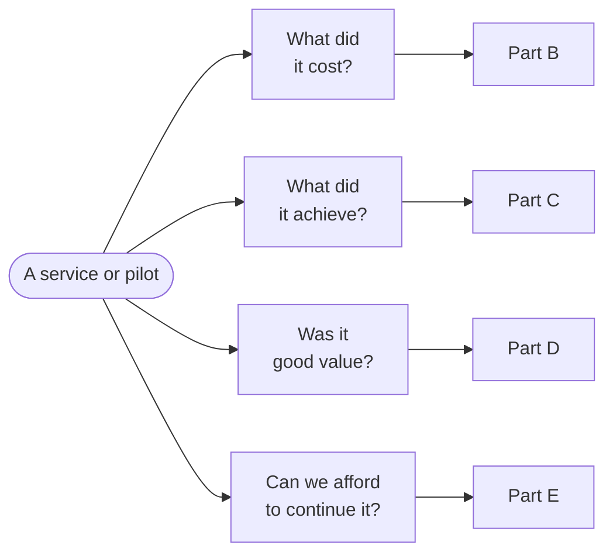

# Healthcare Economics Toolkit

Costing and value for money in sexual health and HIV prevention.

The toolkit sets out how Pathway Analytics answers the four questions every service or pilot has to answer: **what did it cost, what did it achieve, was it good value, and can we afford to continue it?** It brings together methods, rules of practice, templates and an evidence library, built for English commissioning. It assumes no training in economics.

Figure 0.1. Four questions organise the toolkit. Each part answers one of them.

## Who it is for

Commissioners, directors of public health, NHS and voluntary-sector service leads, finance colleagues, boards and funders who need to judge whether a service or pilot is worth paying for, and how to pay for it.

## The approach in short

- **Start with the decision, not the method.** Work out who has to decide what, by when, from which budget — then choose the analysis that answers that question.
- **Design the evidence before delivery starts.** Agree the data each claim needs in advance, in a minimum viable dataset no larger than those claims require.
- **A pilot's cost is not the price of keeping it.** Report three cost views side by side — top-down investment, bottom-up delivery and recurrent continuation — and never add them together.
- **Report only as far as the data go.** Name the retention endpoint; 90 days and six months are different measures.
- **Value is a judgement, not a ratio.** An ICER is read against comparable routes, the comparator and a break-even reference point, alongside reach and equity.
- **Affordability is a separate test.** A route can be good value to the health system and still unaffordable to the body that pays for it.

## The four questions

  <a href="#/healthcare-economics-toolkit/foundations" class="nav-card">
    <h3>Foundations</h3>
    
Start with the decision, design the evidence before delivery, and the economics in plain English.

  </a>
  <a href="#/healthcare-economics-toolkit/cost" class="nav-card">
    <h3>What did it cost?</h3>
    
Three views of one route: top-down investment, bottom-up delivery and recurrent continuation.

  </a>
  <a href="#/healthcare-economics-toolkit/achievement" class="nav-card">
    <h3>What did it achieve?</h3>
    
Outcomes, the PrEP cascade, retention, and equity — who is reached and who progresses.

  </a>
  <a href="#/healthcare-economics-toolkit/value" class="nav-card">
    <h3>Was it good value?</h3>
    
Reading an ICER, savings and the wrong pocket, uncertainty, and judging value for money.

  </a>
  <a href="#/healthcare-economics-toolkit/continuation" class="nav-card">
    <h3>Can we afford to continue it?</h3>
    
Continuation, affordability and commissioning under the Provider Selection Regime.

  </a>
  <a href="#/healthcare-economics-toolkit/using-the-toolkit" class="nav-card">
    <h3>Using the toolkit</h3>
    
Rules of practice and reporting, the evidence base, templates and glossary.

  </a>

## Worked examples

Two worked examples run through the toolkit:

- **Route X** — an invented, nurse-led PrEP offer run from community women's health hubs, followed from the first decision to the council report. Its figures are illustrative and used consistently from module to module.
- **The BSWL PrEP Bundled Pathways Pilot** — the real, EJAF-funded evaluation in Liverpool, West Sussex and Brighton & Hove, shown to illustrate how each method is being applied. No pilot findings are reported.

## How to cite

Pathway Analytics (2026). *Health economics toolkit: costing and value for money in sexual health and HIV prevention.* London: Pathway Analytics Ltd.
