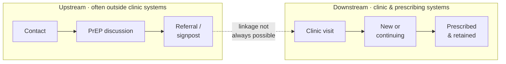

# Part C — What did it achieve?

## 5. Outcomes, the cascade and retention

An outcome is a change in someone's situation, not an activity count. For PrEP the outcomes run from reaching someone, through starting PrEP, to staying on it while at risk. The outcomes that matter most — HIV infections averted and the health and costs that follow — are rarely observable in a short evaluation and have to be estimated.

### 5.1 Report at the highest step the data support

| Step | Outcome | What it needs |
|------|---------|---------------|
| 1 | Observed cascade: people reached, assessed, started and retained | Linked person-level records |
| 2 | Person-years on PrEP | Start and stop dates, or a retention measure and an assumption about duration |
| 3 | HIV infections averted directly, under stated incidence scenarios | HIV incidence for the people reached; PrEP effectiveness |
| 4 | Infections averted including onward transmission | A transmission model calibrated to the population |
| 5 | Lifetime QALYs and costs | All of the above, plus lifetime treatment costs and quality-of-life data |

*Table 5.1. The evidence ladder. Each step up adds assumptions, which must be stated.*

### 5.2 The PrEP cascade

The most widely used framework sets out nine stages, from identifying people at risk to retention, and four retention categories: still indicated and retained; still indicated but not retained; no longer indicated; and lost to follow-up [16]. UKHSA's national monitoring uses a shorter cascade among people attending sexual health services: PrEP need, need identified, and PrEP started or continued [17].

### 5.3 Upstream activity is not a denominator

Community and signposting work often happens before anyone is identified. Contacts, discussions and referrals are real outputs, but they are activity, not a base for conversion rates. Report a conversion from referral to clinic attendance only where a valid linkage key traces the same person through both.

Figure 5.1. Upstream signposting and downstream clinical care are related but distinct. Report a conversion only where it can be traced.

> **Important: Denominator rule.** Report cost per person retained only where the route can be linked and retention is measured consistently. Otherwise name the last stage that can be traced. Missing linkage is a finding about how evaluable the route is, not an invitation to construct a denominator.

### 5.4 Name the retention endpoint

Retention is the outcome most open to argument, so fix its definition in advance: for example, a further PrEP prescription or supply within a set window after starting. Count only people who have been in the service long enough to be followed up, and report separately those who stopped because they are no longer at risk; they have not failed.

Ninety-day and six-month retention are different endpoints. Each needs its own eligible cohort, observation window and date-based definition, and one is not a proxy for the other without an explicit, justified model.

| Endpoint | What it shows | Share of a person-year | Typical use |
|----------|---------------|------------------------|-------------|
| Retained at 90 days | Early persistence | About a quarter | Cascade tables |
| Retained at six months | Sustained use while at risk | About a half | Incremental analysis (ICERs) |

*Table 5.2. Two retention endpoints. They are not interchangeable.*

### 5.5 Cost per person depends on the stage and the cost view

> **Note — Route X: the cascade over 18 months.** Route X's records link hub attendance to prescribing, so it can be costed to retention.

| Stage | People | Delivery cost per person | How it is calculated |
|-------|--------|--------------------------|----------------------|
| Outreach contacts (anonymous) | 1,200 | £10 | Outreach costs only (£12,000), because contacts cannot be followed |
| Attended a hub PrEP discussion | 300 | £300 | £90,000 ÷ 300 |
| Assessed as eligible | 210 | — | Reported as a count |
| Started PrEP | 120 | £750 | £90,000 ÷ 120 |
| Retained at 90 days | 66 of 105 | — | 105 started at least 90 days before the data cut-off |
| Retained at six months | 45 of 90 | £1,500 | 90 started early enough to be followed; their share of delivery cost (£67,500) ÷ 45 |

*Table 5.3. Route X: the cascade and delivery cost per person (illustrative). Six of the 90 stopped because they were no longer at risk; they are reported separately.*

The cohort adjustment matters. Only 90 of the 120 people who started can be followed for six months, so only their share of the cost — 90/120 of £90,000 — is set against the 45 retained. Dividing all costs by the 45 would overstate the cost per person retained by a third.

The three cost-view figures for cost per person retained at six months are all correct, and each answers a different question. **£2,833** tells the funder what its grant bought; **£1,500** shows what delivery consumed; **£1,280**, from £64,000 a year at a steady state of 100 starts and 50% retention, is what a commissioner would pay. Quoting the first as if it were the third is the most common error in pilot evaluation.

### 5.6 Benchmarks

| Measure | Figure | Source |
|---------|--------|--------|
| Stopping PrEP within six months, all studies | 41% | Global meta-analysis [18] |
| … among gay and bisexual men and trans women | 31% | [18] |
| … among heterosexual populations | 72% | [18] |
| Still on oral PrEP at 12 months, NICE committee assumption | About 57% | Our calculation from the committee's monthly discontinuation rates [19] |
| HIV incidence on PrEP in the PrEP Impact Trial | 0.13 per 100 person-years, against 0.95 among non-trial attendees | [20] |

*Table 5.4. Retention and effectiveness benchmarks.*

Lower retention on routes that reach heterosexual women and migrants than in clinic services for gay and bisexual men is expected. On its own it is not evidence that a route has failed.

> **Illustration from the BSWL evaluation.** Retention is a separate follow-up endpoint, reported only for people in the pilot long enough to be followed. The cascade tables use a 90-day measure. The incremental analysis, following the evaluation's concept note, uses six-month retention with an agreed date-based proxy, because recorded retention fields are incomplete. The two are labelled and never mixed.

---

## 6. Equity: who is reached, and who progresses

For PrEP in particular, who is reached is the central result. It belongs in the main tables, not an appendix.

### 6.1 The gap PrEP routes are trying to close

In 2024, 79.4% of White gay and bisexual men attending sexual health services with a PrEP need started or continued PrEP; for Black African heterosexual women the figure was 34.6% [17]. After national commissioning began, that gap widened [21], and an estimate of need across the whole population suggests most heterosexual women with a need never access PrEP through a sexual health service [22]. The HIV Action Plan for England 2025 to 2030 asks directors of public health to increase the proportion of heterosexual and Black and minority ethnic people offered PrEP by 2028 [23].

### 6.2 Two questions, not one

Equity has two measurable dimensions: who is reached, and what happens once they engage. Report both, within comparable groups, or a rise in contacts among a priority group can be mistaken for a rise in equitable PrEP starts.

> **Note — Route X: who was reached, and who progressed.** Of the 120 people who started PrEP, 84 (70%) were from the priority groups, against 15% of women starting PrEP at the clinic before the pilot.

| Group | Attended a discussion | Started PrEP | Retained at six months (of those followed) |
|-------|----------------------:|-------------:|--------------------------------------------:|
| Priority groups | 198 | 84 (42%) | 30 of 63 (48%) |
| Others | 102 | 36 (35%) | 15 of 27 (56%) |
| **All** | **300** | **120 (40%)** | **45 of 90 (50%)** |

*Table 6.1. Route X: reach and progression by group (illustrative).*

Route X reaches the priority groups far better than the clinic did, and converts them to PrEP at least as well, but retains them less well. That points to the follow-up model, not the outreach, as the thing to strengthen.

### 6.3 Four levels of equity analysis

In rising order of demand on the data:

1. Breakdowns by sex, age, ethnicity, deprivation, migration status and route in every core table.
2. PrEP use against estimated need for each group [21].
3. A structured process such as the Health Equity Assessment Tool [24].
4. Distributional cost-effectiveness analysis where the data allow [25, 26].

Reaching people who do not use services usually costs more per person and can still be good value [6]; show that trade-off rather than hiding it in an average.
