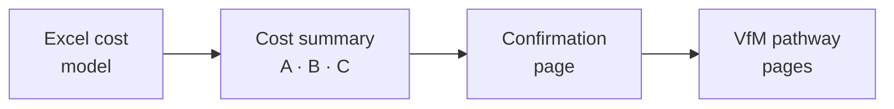

# Part E — Can we afford to continue it?

## 11. Continuation, affordability and commissioning

Good evidence is wasted if it does not reach the decision in a form the decision maker can use. This module covers who pays, how to test whether a route can continue, and where economic evidence enters commissioning and procurement in England. It is not legal or procurement advice.

### 11.1 Who pays for PrEP

Councils fund sexual health services, including PrEP delivery, from the ring-fenced Public Health Grant; NHS England funds the PrEP drug [10]. PrEP money began as a separate grant in 2020/21 [37] and is now part of the grant baseline. The 2026/27 grant is the first three-year settlement in a decade, with later years indicative, and it has no PrEP-specific line [38]. Where the PrEP drug budget will sit after NHS England is abolished had not been confirmed at the time of writing.

### 11.2 Two tests: affordable and sustainable

- **Affordable:** can the body that would pay fund the recurrent continuation cost within its budget over the planning period?
- **Sustainable:** can the route keep running without the pilot's extra support, meaning its staff, capacity, licences, data flows and a named owner?

A route can be good value to the system and still be unaffordable to the body that has to fund it, and the pick-up of a post is not the same as continuation of the route it served.

| Continuation position | Meaning |
|-----------------------|---------|
| Continue | Good value on the evidence available, affordable and sustainable |
| Continue with conditions | Worth continuing if named conditions are met: for example, lock the staffing model, confirm the payer, resolve a licence |
| Do not continue | The evidence does not support continuation in its current form |
| Cannot say yet | The evidence does not yet go far enough. This describes the evidence, not how the route performed |

*Table 11.1. Continuation positions, each tied to its evidence confidence.*

### 11.3 Budget impact over the settlement period

A budget impact analysis sets out what a decision would cost a named budget, year by year. Match the horizon to the budget: three years fits the current Public Health Grant settlement. Include recurrent cost at realistic activity, any ramp-up, displaced costs only if they will actually be released, inflation and one-off transition costs. Show the drug separately.

| | Year 1 | Year 2 | Year 3 | Total |
|---|---:|---:|---:|---:|
| Recurrent continuation cost (3% a year uplift) | £64,000 | £65,920 | £67,898 | £197,818 |
| One-off transition | £5,000 | — | — | £5,000 |
| **Council budget impact** | **£69,000** | **£65,920** | **£67,898** | **£202,818** |
| PrEP drug (NHS England) | Shown separately | Shown separately | Shown separately | — |

*Table 11.2. Route X: three-year budget impact for the council (illustrative).*

### 11.4 The Provider Selection Regime

The Provider Selection Regime (PSR) has applied to health care services in England since January 2024, with statutory guidance reissued in April 2025. It covers services arranged by councils that focus on preventive public health, including sexual and reproductive health [31]. It offers five routes to award: Direct Awards A, B and C, the Most Suitable Provider process, and a competitive process. Decisions under every route are made against five key criteria, and commissioners must be able to justify how they weighed them.

| Key criterion | Economic evidence that supports it |
|---------------|-----------------------------------|
| Quality and innovation | Outcomes by cascade stage; evidence confidence; what is new |
| Value | Recurrent continuation cost; cost per person at each stage; ICER where available; budget impact; savings by type |
| Integration, collaboration and service sustainability | Payer; links with other services; what continuation would require |
| Improving access, reducing health inequalities and facilitating choice | Reach and outcomes by group, set against need |
| Social value | Wider benefits, such as community partners' involvement |

*Table 11.3. PSR key criteria and the evidence that supports each.*

The guidance describes value as "the balance of costs, overall benefits and the financial implications" [31].

### 11.5 Most routes continue as contract changes

Routes that survive a pilot are usually added to an existing contract rather than procured separately. A modification that would materially change a contract's character needs a new selection process. A commissioner-driven modification whose cumulative effect on lifetime value is £500,000 or more needs a transparency notice, and the £500,000 and 25% figures also appear in the conditions for permitted modifications [31]. State the recurrent cost of each route over the remaining life of the contract so that the commissioner and procurement advisers can test it. Route X's three-year cost of £202,818 is below the transparency-notice figure on its own, but all changes to the contract count towards the cumulative total.

### 11.6 Keep a record as you go

In November 2025 the Independent Patient Choice and Procurement Panel found breaches in a direct award where the scoring "lacked coherence" and decision records had been amended after the award [39]. A value-for-money report structured around the key criteria, written before the decision, is the record a commissioner needs. Goods, digital platforms and other non-health-care elements may fall under the Procurement Act 2023 instead, with councils having regard to the National Procurement Policy Statement [40].

### 11.7 Write for the council decision report

Council decision reports on sexual health contracts tend to state value for money in a sentence; the ones we reviewed cited no formal economic analysis [41, 42, 43]. A one-page insert in the council's own format is often worth more than a model.

| Field | Route X |
|-------|---------|
| Decision sought | Fund Route X from April as a variation to the integrated sexual health contract, for three years. |
| What it costs | £64,000 a year recurrent; £202,818 over three years including £5,000 transition. PrEP drug funded by NHS England, shown separately. |
| Who pays, who benefits | Council (Public Health Grant). Treatment costs avoided fall to the NHS. No cashable saving or capacity release is claimed. |
| What it delivers | About 100 PrEP starts a year at steady state; 50% retained at six months; £1,280 per person retained. |
| Value | £1,708 per additional person retained at six months against the clinic as usual; stable within about 15% in sensitivity analysis. |
| Inequalities | 70% of starts from priority groups, against 15% at the clinic. Retention lower in those groups; follow-up to be strengthened. |
| Evidence confidence | Nesta level 2: a baseline comparison, no concurrent control. |
| Recommendation | Continue with conditions: confirm funding for the navigator post; bring nurse sessions into the contract; record route of origin. Review at 12 months. |

*Table 11.4. Route X: a completed value-for-money insert (illustrative). A blank template is in [Annex A3](/healthcare-economics-toolkit/using-the-toolkit?id=annex-a-templates).*

### 11.8 Timing decides influence

Councils set budgets in February and March. Evidence that arrives after budget-setting will influence the following year at best. Plan an interim note on recurrent continuation cost in time for the budget cycle, even if the final evaluation comes later.

Figure 11.1. From each site's cost model to confirmed figures: a collaborative process validated with local teams, not assumed.

> **Illustration from the BSWL evaluation.** Public procurement notices show that all three councils recently re-let or extended their integrated sexual health contracts to NHS providers. West Sussex ran a PSR competitive process for a seven-year contract from August 2026, weighting value at 10% and access, inequalities and integration at 40% combined [44]. Brighton & Hove published an intention to award through the Most Suitable Provider process [45]. Liverpool approved a three-year continuation of its service, with a contract variation adding new prevention elements [43].
>
> Any continuation of the pilot routes is therefore most likely to be a contract variation, so the evaluation reports recurrent cost against the PSR modification conditions. And where access and inequalities carry four times the weight of value, who a route reached will count for more than any ratio.
