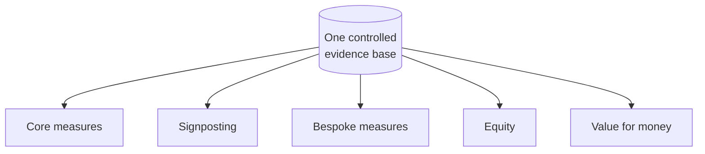
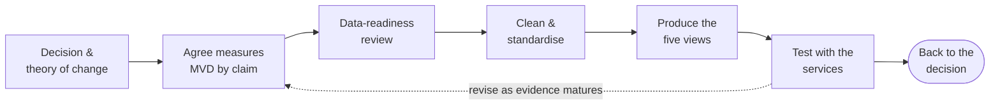

# Part A — Foundations

## 1. Start with the decision

Economic evaluation exists to help someone with a fixed budget make a choice. Before any costing, write down who the decision maker is, what they are choosing between, when they must decide, which budget the money comes from and what they need to see. The method follows from those answers.

### 1.1 Each question has its own method

| If the question is… | Use | Main output |
|---------------------|-----|-------------|
| What did the money buy? | Cost analysis (top-down) | Investment by category, site and route |
| What would it cost to run each year? | Recurrent continuation cost | Annual cost without one-off pilot costs |
| What do we get for what we spend, across several outcomes? | Cost-consequence analysis | Costs alongside reach, uptake, retention, equity and service effects |
| Is it better than the alternative on one outcome? | Cost-effectiveness analysis | Incremental cost per additional outcome (ICER) |
| How does it compare with other uses of NHS money? | Cost-utility analysis | Cost per quality-adjusted life year (QALY) |
| Can we afford it? | Budget impact analysis | Cost to a named budget over one to five years |
| Is it good value overall? | Value-for-money judgement | The five Es, judged against standards agreed in advance |

*Table 1.1. Decision questions and the method that answers each.*

### 1.2 Settle five things before you start

- **The decision.** Who decides, what they are deciding and by when. A council setting its budget in February needs figures in December.
- **The options.** Always include business as usual. The realistic choice is rarely "new route or nothing"; it is usually "new route or the clinic as it is now".
- **The perspective.** Whose costs and benefits count: the council, the NHS, the wider public sector or society.
- **The outcome.** The furthest outcome the data can support. For a short pilot this is usually people reached, started and retained, not infections averted.
- **What good looks like.** What result would count as adequate, good or excellent value, agreed before the results are known.

> **Note — Route X: the decision.** The council must decide by December whether to fund Route X from April, once the grant ends. The money would come from the Public Health Grant, and the route would be added to the existing integrated sexual health contract. The comparator is the clinic as it worked before the pilot. The perspective is the council's, with NHS costs shown separately. The outcome is people retained on PrEP at six months.

> **Illustration from the BSWL evaluation.** EJAF funding ends in March 2027. The three councils and their NHS partners must then decide whether to keep any of the new routes, what that would cost each year, which budget pays and through which procurement route. The evaluation is built backwards from that decision. It does not set out to show that PrEP works; that is established. It asks whether the new routes reach people the clinic was not reaching, at what cost, and what it would take to keep them.

---

## 2. Design the evidence before delivery starts

A method is only as good as the data that can feed it. The first deliverable of a serious evaluation is therefore a measurement specification, not a dashboard. It connects the theory of change for each route to its unit of analysis, the identifiers available, the outcomes that can be measured, the resource inputs and the comparator. An early data-readiness review then shows which claims will be defensible and which will stay descriptive.

This costs far less before delivery starts than after. Gaps in coding found once a pilot is running are expensive to repair, and some cannot be repaired at all.

### 2.1 Five lenses on one evidence base

Most service evaluations need to look at the same activity in five ways. These are analytical views, not separate datasets.

- **Core measures** follow people through common clinical stages.
- **Signposting** records upstream contacts, discussions and referrals.
- **Bespoke measures** capture what is distinctive about a route.
- **Equity** asks who can be identified and how they progress.
- **Value for money** places cost, the counterfactual and continuation alongside the outcomes.

Figure 2.1. Five analytical lenses share one controlled evidence base — never added together.

The lenses must not be added together: an anonymous outreach contact and a patient record are different units.

### 2.2 A minimum viable dataset, set correctly and in proportion

A minimum viable dataset (MVD) is a common data specification. It is **not** a demand that every provider use the same patient-record system. It fixes the definitions and fields needed to produce comparable analyses across sites and routes, while keeping local source provenance and route-specific detail.

Setting it correctly means every field has a definition, a unit, a denominator, a date and a source, and absence is recorded as absence. Setting it in proportion means asking only for what the evaluation's claims require. Start from the claims, not from the data.

| Tier | What it includes | When it is needed |
|------|------------------|-------------------|
| Essential for every route | Site and route identifiers; reporting period and activity date; the stage and unit counted; numerator and denominator definitions; source system and extraction date; basic population fields where available; resource and cost attribution; missingness | Always. Without these, no route can be reported consistently |
| Essential for a claim | A patient or referral linkage key; follow-up dates; a defined eligible cohort; a comparator; attributable incremental cost | Only where the evaluation will make the claim that depends on them, such as referral conversion, retention or an ICER |
| Desirable extensions | Patient experience; richer equity markers; detailed resource use; inputs for long-term modelling | Where they add value and services can supply them without strain |

*Table 2.1. The three tiers of a minimum viable dataset.*

> **Note — Route X: claims first, then fields.** Route X will make four claims, and each one sets the fields it needs:
> - Cost per person engaged: a hub attendance log with dates (every route).
> - Cost per person started: prescriptions carrying a route-of-origin code (every route).
> - Cost per additional person retained at six months: a linkage key, start and follow-up dates, and the clinic's baseline for the same population (a claim-specific tier).
> - Who was reached: sex, age, ethnicity and migration status, recorded at first contact (every route where available).
>
> Patient experience is desirable but is not needed for any of the four claims, so it is collected through a short survey rather than added to clinical records.

### 2.3 Say why a measure is absent

An absence code is more informative than a blank. Five codes cover most cases, and they separate a stage that does not exist from a data system that failed.

| Code | Meaning |
|------|---------|
| Not applicable | The stage does not exist for this route, for example prescribing in an awareness-only activity |
| Not measured | The stage exists but no field records it |
| Not linkable | The data exist but cannot be joined to the person or to the next stage |
| Not yet mature | Too little time has passed, for example for a six-month retention endpoint |
| Not defensible | Data exist but are too incomplete or inconsistent to report |

*Table 2.2. Absence codes.*

> **Important: Absence rule.** Never record missing data as zero. A zero or a blank where data are missing produces false conversion rates and false unit costs. Record why the value is absent.

### 2.4 Information governance comes first

Linking records across a hub, a clinic and a digital platform involves special category health data, so the legal and ethical groundwork must be in place before the first record is shared. In practice that means:

- A **data-sharing agreement** that names each organisation, the fields shared, the purpose and how long the data are kept.
- A **data protection impact assessment**, which is usually needed for processing of this kind [1].
- **Pseudonymised linkage**: a key that joins records without moving names or NHS numbers further than necessary, consistent with the Caldicott Principles [2].
- Agreed **suppression rules** for small numbers, applied before anything is published.

Each organisation's information governance lead should be involved early. This toolkit is not legal advice.

### 2.5 The design sequence

The sequence is iterative. Agree the question and the theory of change; test whether the MVD fields exist and how they are coded; clean and standardise routine records; produce the core, signposting, bespoke, equity and cost views; test the interpretation with the services that supplied the data; and revise as the evidence matures.

Figure 2.3. From the decision, through agreed measures and data readiness, to analysis and back to the decision.

> **Illustration from the BSWL evaluation.** The evaluation agreed a minimum viable dataset with the three sites. The report sets out what was agreed and what arrived, dataset by dataset, which comparisons each permits, and where records link and where they break. Where linkage breaks — for example for anonymous outreach or for records held on a separate clinical system — the analysis stops at the last defensible stage rather than estimating across the gap.

---

## 3. The economics in plain English

Health economics compares the costs and consequences of two or more options so that someone with limited money can judge whether a change is worth paying for. A study that describes only costs, or only outcomes, is a partial evaluation. It may be useful, but on its own it cannot say whether something is good value [3].

### 3.1 Six ideas do most of the work

- **Opportunity cost.** Money spent on one service is not available for another. The real cost of a choice is the best alternative given up.
- **The comparator.** Every result is relative to something. Name it: business as usual, a different model, or doing nothing.
- **The counterfactual.** What would have happened anyway. Someone who would have come to the clinic regardless and used a new online route instead is a channel shift, not an extra person on PrEP.
- **Incremental thinking.** Compare the extra cost with the extra benefit, not the total cost with the total benefit.
- **Average and marginal cost.** The average cost per person over a pilot includes set-up. The cost of one more person, once the service is running, is usually much lower.
- **Time.** Costs often come now and benefits later, so future values are discounted (section 3.3).

### 3.2 Whose costs count

The perspective decides which costs and benefits are counted. Choose it to match the decision maker, and show others as scenarios where they matter.

| Perspective | What it counts | When it fits |
|-------------|----------------|--------------|
| NHS and personal social services | Costs to the NHS and adult social care; health benefits to patients | NICE technology appraisals [4] |
| Local authority | Costs falling on the council, mainly the Public Health Grant | A council deciding whether to commission or continue a service |
| Public sector | Costs and savings across the NHS, councils and other public bodies | Public health decisions that cut across organisations [5] |
| Societal | All costs and benefits, including to patients, carers and employers | Green Book appraisal and cost-benefit analysis [6] |
| Funder | The funder's own investment and what it bought | Reporting to a charitable funder, alongside a commissioner view |

*Table 3.1. Common perspectives in English health and public health decisions.*

### 3.3 Discounting matters only over long horizons

NICE and the Green Book discount future costs and benefits at 3.5% a year, and the Green Book uses 1.5% for health effects [4, 6]. A review published in June 2026 recommended a lower standard rate; until HM Treasury responds, 3.5% applies [7]. For a pilot lasting two years discounting makes little difference. It matters when results are projected over decades, for example lifetime HIV treatment costs.

### 3.4 Cost-consequence analysis is a choice, not a fallback

The standard types of economic evaluation differ mainly in how they measure outcomes: not at all, in natural units such as people retained on PrEP, in QALYs, or in money [3, 4, 6].

| Method | Strength | Main pitfall |
|--------|----------|--------------|
| Cost analysis | Essential first step; shows what drives cost | No outcomes, so cannot support a value-for-money claim on its own |
| Cost-consequence analysis | Keeps trade-offs visible across several outcomes | The reader does the weighing, which invites cherry-picking |
| Cost-effectiveness analysis (ICER) | Simple, intuitive single ratio | One outcome only; no external threshold for most natural units |
| Cost-utility analysis (per QALY) | Comparable across all of health care; NICE standard | Needs quality-of-life data and long-term modelling |
| Cost-benefit analysis and return on investment | Speaks the language of finance | Savings often fall to another budget and are rarely cashable |
| Budget impact analysis | Answers the finance question directly | Says nothing about value |

*Table 3.2. Types of economic evaluation.*

Short pilots rarely have the data for a credible cost per QALY: follow-up is too short, numbers are small, and HIV incidence is not known for the groups reached. A well-built cost-consequence analysis, with an ICER only where the data support one, is the more defensible choice. NICE's methods for public health recognise cost-consequence analysis where outcomes span sectors [5], and the MRC/NIHR framework for complex interventions accepts broader approaches for service-level change [8]. Its weakness — that the reader does the weighing — is answered by agreeing in advance what good value looks like (Module 10).

> **Important: Reading rule.** Every headline figure states its cost view, time period, denominator, comparator and evidence confidence. "£X per person" means nothing until the reader knows whether it is set-up or recurrent, over which months, per person reached or per person retained, compared with what, and how firm it is.
