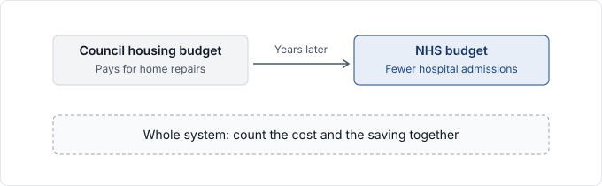

# What Is Health Economics For?

**Health, fairness and the value of public resources**

*Bella Grant, Pathway Analytics | November 2026*

We spend a great deal of time debating how much healthcare costs: what we can afford, where savings can be made and how to show value for money.

These are perfectly legitimate questions. Public resources are finite, and every pound spent on one intervention is a pound unavailable for something else. Understanding those choices is central to good public policy.

But I increasingly wonder whether we are asking too narrow a set of questions.

I would rather start with the kind of society we want to create, and use economics to understand how to improve health itself and share the opportunities for good health more fairly. Many of the decisions that matter most for population health are made well outside the healthcare system.

This matters now. Health inequalities remain wide, public finances are under pressure and we understand more than we did about what determines health.

## The problem with starting at the wrong end

Health economics has developed sophisticated methods for comparing treatments, evaluating interventions and assessing the benefits delivered by public expenditure.

This is valuable work. Without it, decisions risk being driven by institutional interests, political pressure or whoever makes the most persuasive argument.

But there is a danger when economic evaluation becomes too narrowly focused on the immediate costs and measurable outputs of individual services.

Consider two hypothetical healthcare programmes. Both cost £1 million. Both reach 1,000 people. Both appear to deliver comparable clinical benefits. The difference is that one reaches people who already have relatively good access to healthcare, while the other reaches a population that has historically been excluded or underserved.

Are these programmes equally valuable?

In a conventional analysis, they might appear similar. But if we are concerned with reducing avoidable health inequalities, the distribution of those benefits matters.

Reaching underserved populations may also require more intensive outreach, longer consultations, interpretation, transport assistance or additional support.

A programme that costs more per person may nevertheless represent a better use of public resources if it meets real unmet need and delivers benefits that would otherwise not occur.

That does not mean we should disregard cost-effectiveness. We still need to understand whether the additional investment produces additional benefits, how substantial those benefits are and what other services might be displaced. We also need to think harder about what we mean by value.

> If we're serious about improving population health, how much benefit an intervention delivers is only half the question. The other half is who receives it.

## Health is produced well beyond the healthcare system

One of the most important contributions of public health research over recent decades has been to show how much health is shaped by circumstances outside healthcare.

Income, education, housing, employment, food, environmental conditions and social relationships all affect our chances of living a long and healthy life.

The work of Michael Marmot and others has established that health inequalities are not simply the consequence of individual choices or differences in access to medical treatment. They are deeply connected to the conditions in which people live.

We spend heavily on treating respiratory illness while tolerating poor housing conditions that contribute to it. We fund ever more sophisticated interventions for diabetes while struggling to address the economic and commercial environments that influence diet and physical activity.

We invest in mental health treatment while giving insufficient attention to insecure employment, poverty, social isolation and the wider conditions that affect psychological wellbeing.

People still need effective treatment, and they need it now. The question is how we divide collective resources between treating illness and preventing it.

If we know that the conditions in which people live are major determinants of their health, why do we so often evaluate expenditure on healthcare separately from expenditure on the things that help keep people healthy?

Part of the answer is institutional. Budgets are divided between organisations, departments and tiers of government. Benefits may emerge years later, sometimes in a different part of the public sector.

A housing intervention might reduce future hospital admissions. Better education might improve lifetime health. Effective prevention may reduce healthcare needs many years after the original expenditure.

Yet the organisation paying for an intervention may receive little direct financial benefit from it.

For an individual budget-holder, declining to invest may be rational. For society, it may be very short-sighted.

> What is financially efficient for one organisation is not necessarily economically efficient for the system as a whole.

## The hidden influence of funding systems

Another part of health economics that I think matters a great deal is how funding systems shape what organisations do.

Funding arrangements are rarely neutral. How we pay for services affects what organisations choose to provide, what they prioritise, how they organise themselves and sometimes even which populations they are most willing or able to serve.

Payment by activity may encourage throughput but can also create incentives to prioritise activities that attract reimbursement rather than those that deliver the greatest population benefit.

Fixed budgets may encourage efficiency and integration but can also create incentives to restrict activity or defer costs elsewhere.

Outcome-based funding sounds attractive, but outcomes are often difficult to measure, influenced by factors outside providers' control and vulnerable to unintended consequences if poorly designed.

Each can work, depending on how it is designed and implemented.

I learnt this designing the integrated sexual health tariff. Hospital sexual health clinics were paid per attendance under the national tariff, which overpaid much of their activity relative to cost, while contraception services sat on block contracts and were comparatively underfunded. The payment rules worked against integrated care. Changing them was less a costing problem than a question of who stood to lose. The strongest resistance came from hospital finance directors and clinical leads, for whom the old tariff was valuable. What worked was building the care pathways with clinicians from both services, so the evidence was theirs rather than ours.

We need to understand the economics of the whole system as well as the costs of its parts.

That means asking who has an incentive to change, who gains from current arrangements and who bears the cost of reform.

These are economic questions, but they are also questions about organisations, governance and power.

A technically elegant funding model will achieve very little if it ignores the institutional realities into which it is introduced.

## Who benefits and who is left behind

Health equity introduces a further challenge to conventional economic decision-making.

A programme can improve average population health while simultaneously widening inequalities.

Imagine a new preventive service introduced across a population. People with higher incomes, better education and easier access to healthcare may be the first to take advantage of it. Overall uptake rises and the programme looks successful, while those facing the greatest barriers see little improvement.

If our principal measure is total activity or aggregate health gain, we could conclude that the intervention is working extremely well.

Yet from an equity perspective, the picture is incomplete.

Evaluating prevention and outreach services has made me wary of mistaking activity for impact. A programme can report thousands of contacts and referrals. The harder question is how many of those people would have got care anyway, and what we know about the people who never came through the door.

It helps to keep three ideas apart. A programme can be cost-effective without being affordable, fair without being cost-effective, or cost-saving without doing anything to reduce inequalities.

This is one reason why the development of distributional cost-effectiveness analysis is so interesting. Researchers, including those at the University of York, have developed methods that examine not only aggregate health benefits and opportunity costs, but also how they are distributed between different population groups.

What these methods do is make the choices about fairness visible.

Should we attach additional weight to improving the health of people who are already disadvantaged? Under what circumstances might we accept a smaller overall health gain in return for a fairer distribution?

These are not questions that economics alone can answer. They involve ethical judgements and democratic choices about what society values. Economics can help us understand the consequences of those choices rather than leaving them implicit or obscured within aggregate figures.

## The economics of prevention

Prevention is frequently described as an investment, yet it is often among the first areas placed under pressure when budgets tighten.

There are understandable reasons for this. Prevention can involve upfront expenditure, uncertain outcomes and benefits that may not become apparent for years.

It is also important not to assume that every preventive intervention saves money. Some improve health at additional cost and are worthwhile for that reason. Others may prove ineffective or poor value.

The economic case for prevention needs to be demonstrated, not simply asserted.

Even so, conventional budget cycles can systematically undervalue interventions whose benefits emerge over long periods or across different organisations.

The relevant comparison is between the costs and consequences of different courses of action, including doing nothing.

That includes the illness avoided, the treatment costs saved and the effects on families, work and caring responsibilities. It also includes the opportunities for better health lost each time investment in prevention is put off.

These questions become even more pressing when considering disadvantaged populations, where the consequences of untreated illness can compound existing social and economic difficulties.

## Markets, commercial interests and the distribution of power

Health also has a wider political economy.

Commercial activity has brought major benefits to health. Pharmaceutical innovation, medical technologies, improved food systems and private-sector investment have all contributed to advances in human wellbeing.

But commercial incentives do not always align with population health.

The profitability of products, the pricing of essential medicines, the ownership of data and technologies, and the influence of powerful industries over regulation and public policy can all shape health outcomes.

The World Health Organization increasingly recognises these as commercial determinants of health.

This raises questions that go beyond the usual boundaries of healthcare economics.

They include who decides which research is funded, how the benefits of publicly funded innovation are shared and when governments should intervene in markets to protect population health.

Markets remain powerful mechanisms for innovation, production and allocating resources. But they operate within legal, institutional and political frameworks that societies create and can change.

The task is to understand where markets serve public wellbeing and where they don't.

## What should we actually be trying to maximise?

The most basic question is what an economy is for.

We generally measure economic success through indicators such as GDP, productivity, investment and growth.

These measures provide useful information. A prosperous economy can generate resources that support better public services and living standards.

But an economy can grow while leaving large sections of its population facing deteriorating health, insecurity or limited opportunities.

Activities that contribute a great deal to wellbeing, such as unpaid care, community support, prevention and healthy environments, are poorly reflected in conventional economic measures.

The WHO Council on the Economics of Health for All, chaired by Mariana Mazzucato, has taken this further.

Its central proposition is that health and wellbeing should be explicit objectives of economic policy rather than outcomes we hope will emerge from economic growth.

Rather than asking only how a growing economy can afford better healthcare, we might also ask how economic systems can be designed to support healthier populations.

That has implications for public investment, innovation policy, taxation, education, housing and employment, and for how we measure progress.

Health would cease to be considered primarily as a cost to be managed or an instrument for increasing productivity. It would be recognised as something valuable in its own right: a core part of human wellbeing and opportunity.

## Rigour still matters

There is a risk that broadening health economics in this way becomes an excuse for ambitious aims that are never properly evaluated.

An economic approach concerned with equity and public value must remain disciplined.

Resources are finite. Trade-offs are real. Programmes that sound socially desirable do not necessarily deliver the benefits claimed for them.

We still need rigorous evidence about costs, effectiveness, additionality and outcomes. We need to distinguish between benefits we can demonstrate, those we can reasonably estimate and those that remain uncertain.

We need to be prepared to acknowledge when an intervention does not work.

But we also need to be much more explicit about the assumptions and value judgements embedded in our analyses.

That means being clear about whose costs and outcomes are counted, over what period, against which alternative and how the consequences are distributed.

There will not always be a single objectively correct answer. Sometimes increasing fairness will also increase overall efficiency. Sometimes there will be real trade-offs.

Economics should help us understand those tensions rather than conceal them.

It should also help policymakers and the public make better-informed choices about what they are willing to prioritise.

## Towards a broader health economics

I do not think the answer is to discard the analytical tools that health economists have spent decades developing.

Cost-effectiveness analysis, economic modelling, programme evaluation and careful examination of resource allocation remain essential.

But they need to sit within a broader framework that looks beyond the efficiency of healthcare services to the conditions that determine health, who benefits, the incentives institutions create and the wider effects of economic policy. That means economists working more closely with public health specialists, clinicians, social scientists, communities and policymakers, and keeping the work practical enough to inform real decisions.

When public resources are being allocated, I would add four questions to the usual ones about cost and efficiency:

- What are we trying to achieve, and for whom?
- Who is currently missing out, and why?
- Is this a fair use of resources once we take account of the wider system and the alternatives?
- What are the economic, social and human costs of doing nothing?

These questions will make decisions harder, but I think they will make them better.

> Health economics should help us make the best use of society's resources to improve health and reduce avoidable suffering.

I would like to see us use it more ambitiously.

## Further reading

- World Health Organization (2025). [World Report on Social Determinants of Health Equity](https://www.who.int/publications/i/item/9789240107588).
- WHO Council on the Economics of Health for All (2023). [Health for All: Transforming Economies to Deliver What Matters](https://www.who.int/publications/m/item/health-for-all--transforming-economies-to-deliver-what-matters).
- Institute of Health Equity (2020). [Health Equity in England: The Marmot Review 10 Years On](https://www.health.org.uk/reports-and-analysis/reports/health-equity-in-england-the-marmot-review-10-years-on-0).
- University of York, Centre for Health Economics. [Distributional Cost-Effectiveness Analysis](https://www.york.ac.uk/che/equity/distributional-cost-effectiveness-analysis/).
- World Health Organization. [Commercial Determinants of Health](https://www.who.int/health-topics/commercial-determinants-of-health).

---

[← All Insights](/insights/)
