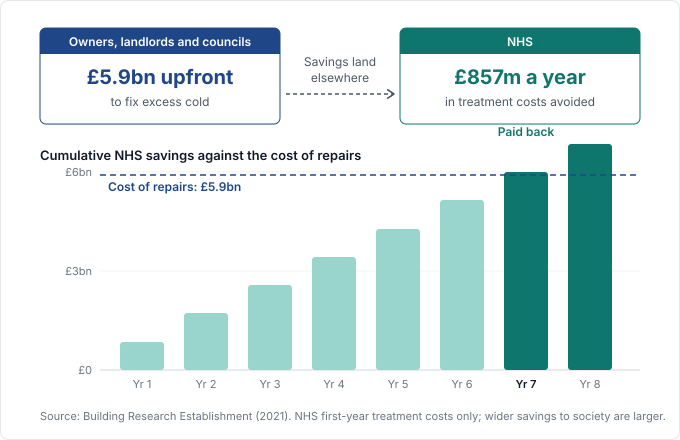

# What Is Health Economics For?

**Health, fairness and the value of public resources**

*Bella Grant, Pathway Analytics | November 2026*

We spend a great deal of time debating how much healthcare costs: what we can afford, where savings can be made and how to show value for money. These are legitimate questions. Public resources are finite, and every pound spent on one intervention is a pound unavailable for something else. Understanding those choices is central to good public policy.

But I increasingly wonder whether we are asking too narrow a set of questions. A man born in one of the most deprived areas of England can expect around 50 years in good health. In the least deprived areas the figure is about 69 years, and for women the gap is slightly wider. Twenty years of healthy life is not a gap we will close by debating unit costs.

I would rather start with the kind of society we want to create, and use economics to understand how to improve health itself and share the opportunities for good health more fairly. Many of the decisions that matter most for population health are made well outside the healthcare system: in housing, employment, local government and the way public money is divided between organisations. This matters now. Health inequalities remain wide, public finances are under pressure and we understand more than we did about what determines health.

## The problem with starting at the wrong end

Health economics has developed sophisticated methods for comparing treatments, evaluating interventions and assessing the benefits delivered by public expenditure. This is valuable work. Without it, decisions risk being driven by institutional interests, political pressure or whoever makes the most persuasive argument. The danger comes when economic evaluation narrows to the immediate costs and measurable outputs of individual services and loses sight of who is benefiting and who is not. HIV prevention shows how easily that happens.

Example: PrEP

Since NHS roll-out in 2020, PrEP has been one of the successes of HIV prevention in England. But in 2024, nearly four in five gay and bisexual men who needed PrEP received it, against just over a third of Black African heterosexual women and men with the same need. The consequences are serious. Half of Black African heterosexuals diagnosed with HIV are diagnosed late, compared with under a third of gay and bisexual men, and people diagnosed late are ten times more likely to die within a year of diagnosis.

Under the integrated sexual health tariff, a council pays around £90 to start someone on PrEP and around £45 for each follow-up, and NHS England pays for the drug. For someone already at ease using a clinic, a year of PrEP appointments costs the council a few hundred pounds. Reaching a woman from a Black African or other migrant community who has never used a sexual health clinic costs more. She may need a community worker, an interpreter or an appointment outside the clinic before the tariff is paid at all, so per person that route will look expensive.

But the clinic is mostly serving people who would probably have found PrEP anyway, and the outreach route is reaching people who would not. If we judge both by cost per person, we will keep funding the first and cutting the second.

A programme that costs more per person may still be a better use of public resources if it meets real unmet need and delivers benefits that would not otherwise happen. That does not mean disregarding cost-effectiveness. We still need to know whether the extra spending produces extra benefit, how much, and what other services might be displaced. But we need to be much clearer about what we mean by value. If we are serious about improving population health, how much benefit an intervention delivers is only half the question. The other half is who receives it.

## Health is produced well beyond the healthcare system

One of the most important contributions of public health research over recent decades has been to show how much health is shaped by circumstances outside healthcare. Income, education, housing, employment, food, environmental conditions and social relationships all affect our chances of living a long and healthy life. The work of Michael Marmot and others has established that health inequalities are not simply the result of individual choices or unequal access to treatment. They are rooted in the conditions in which people live.

Yet we often organise spending as if the opposite were true. We spend heavily on treating respiratory illness while tolerating the poor housing that contributes to it. We fund ever more sophisticated diabetes care while doing little about the commercial environments that shape diet and physical activity, and we invest in mental health treatment while paying less attention to insecure work, poverty and isolation. People still need effective treatment, and they need it now. The question is how we divide collective resources between treating illness and preventing it.

Part of the reason we get this balance wrong is institutional. Budgets are divided between organisations, departments and tiers of government, and the benefits of prevention often arrive years later in a different part of the public sector. A housing intervention might reduce hospital admissions. Better education might improve lifetime health. But the organisation paying for an intervention may see little financial benefit from it. Cold homes are a clear example.

Example: cold homes

Research for Public Health England estimated that more than one in five excess winter deaths in England and Wales are attributable to cold housing. The Building Research Establishment estimates that poor housing costs the NHS around £1.4 billion a year in first-year treatment costs alone, more than half of it from homes that are too cold. Fixing excess cold would cost about £5.9 billion and, on NHS savings alone, pay for itself in around seven years. But the NHS does not pay for the repairs, and the owners, landlords and councils who would pay for them see none of the savings.

For an individual budget-holder, declining to invest may be entirely rational. For society, it is short-sighted. What is financially efficient for one organisation is not necessarily economically efficient for the system as a whole, and the gap between the two is where much of the human cost of poor housing sits.

## The hidden influence of funding systems

Another part of health economics that I think matters a great deal is how funding systems shape what organisations do. Funding arrangements are rarely neutral. How we pay for services affects what organisations choose to provide, what they prioritise, how they organise themselves and sometimes which populations they are most willing or able to serve.

Payment by activity may encourage throughput, but it can also reward the activities that attract reimbursement rather than those with the greatest population benefit. Fixed budgets may encourage efficiency and integration but can also create incentives to restrict activity or push costs elsewhere. Outcome-based funding sounds attractive, but outcomes are often hard to measure, influenced by factors outside providers' control and open to unintended consequences if poorly designed. Each can work, depending on how it is designed and implemented, and getting the design right is rarely just a technical exercise.

Example: the integrated sexual health tariff

Sexual health in England is a clear case. Hospital clinics treating sexually transmitted infections were paid per attendance under the national tariff, which overpaid much of their activity relative to its cost. Contraception services sat on block contracts and were comparatively underfunded. The payment rules worked against integrated care for patients. We designed the integrated sexual health tariff to correct that mismatch, pricing care by clinical pathway rather than by attendance, so that both services were paid on the same costed basis. The costing was the easier part. Some organisations stood to lose, and the strongest resistance came from hospital finance directors and clinical leads, for whom the old tariff was valuable. What worked was building the pathways with clinicians from both services, so the evidence was theirs rather than ours.

The economics of the whole system matter as much as the costs of its parts. Changing how money flows means asking who has an incentive to change, who gains from current arrangements and who bears the cost of reform. These are economic questions, but they are also questions about organisations, governance and power, and they become harder still when no single organisation owns the problem.

Example: sexual assault services

Sexual assault services sit across health, local government, police and justice. Each holds part of the budget and part of the responsibility, and no single body owns the whole pathway. In two national reviews for NHS England, the Home Office and the Ministry of Justice, we mapped where cases fell away between first contact, forensic examination and court. A national group agreed 29 core pathways and a matrix showing which body should fund each step. The analysis was the straightforward part. Each organisation was, understandably, focused on protecting its own budget and meeting its own targets, and a cost avoided in one part of the system rarely counted as a gain in another. In those negotiations it was easy to lose sight of the person at the centre, who needs the whole pathway to work and not just the part a particular budget pays for.

A technically elegant funding model will achieve very little if it ignores the institutional realities into which it is introduced. Good analysis starts from how organisations actually behave, and from the people who fall between them.

How split budgets turn into unequal health

Public money is split between organisations, each with its own budget and targets

↓

Each is judged on its own costs, not the whole system's

↓

Services favour the people who are cheapest and easiest to reach

↓

People facing the most barriers fall between services

↓

Later diagnosis, worse outcomes and higher costs somewhere else

## Who benefits and who is left behind

10.4 years

Gap in male life expectancy between England's most and least deprived areas

79% vs 35%

Share of people who need PrEP who receive it: gay and bisexual men, against Black African heterosexual women

10×

Higher risk of dying within a year for people diagnosed with HIV late

Sources: Office for National Statistics, 2022 to 2024; UK Health Security Agency, 2025.

Health equity raises a further challenge for conventional economic decision-making. A programme can improve average population health while widening inequalities. If uptake is highest among people with higher incomes, better education and easier access to care, the programme looks successful on total activity or aggregate health gain while those facing the greatest barriers see little improvement. Judged on the aggregate figures it is working well. From an equity perspective the picture is incomplete.

Evaluating prevention and outreach services has made me wary of mistaking activity for impact. A programme can report thousands of contacts and referrals. The harder question is how many of those people would have got care anyway, and what we know about the people who never came through the door. It also helps to keep three ideas apart. A programme can be cost-effective without being affordable, fair without being cost-effective, or cost-saving without doing anything to reduce inequalities.

This is why distributional cost-effectiveness analysis is so interesting. Researchers, including those at the University of York, have developed methods that examine not only aggregate health benefits and opportunity costs but also how they are distributed between population groups. What these methods do is make the choices about fairness visible. Should we attach extra weight to improving the health of people who are already disadvantaged? When might we accept a smaller overall health gain in return for a fairer distribution? Economics alone cannot answer these questions. They involve ethical judgements and democratic choices about what society values, but economics can show the consequences of those choices instead of leaving them hidden in aggregate figures.

## The economics of prevention

Prevention is often described as an investment, yet it is often among the first areas placed under pressure when budgets tighten. There are understandable reasons for this. Prevention can involve upfront spending, uncertain outcomes and benefits that may not appear for years. The public health grant shows where that pressure has landed.

Example: the public health grant

Councils pay for sexual health, drug and alcohol services, stop smoking support and health visiting from the public health grant. Between 2015/16 and 2025/26 the grant fell by about a quarter in real terms per person, while NHS spending grew. The cuts were deepest in the most deprived areas, the same places where people can expect around twenty fewer years in good health.

Not every preventive intervention saves money. Some improve health at extra cost and are worthwhile for that reason, while others prove ineffective or poor value. The economic case for prevention needs to be demonstrated, not simply asserted.

Even so, conventional budget cycles systematically undervalue interventions whose benefits emerge over long periods or across different organisations. The relevant comparison is between the costs and consequences of different courses of action, including doing nothing. That includes the illness avoided, the treatment costs saved and the effects on families, work and caring responsibilities. It also includes the opportunities for better health lost each time investment in prevention is put off. Those losses fall hardest on disadvantaged groups, where untreated illness compounds existing social and economic difficulties.

## Markets, commercial interests and the distribution of power

Health also has a wider political economy. Commercial activity has brought major benefits to health, and pharmaceutical innovation, medical technologies, improved food systems and private investment have all contributed to advances in human wellbeing.

But commercial incentives do not always align with population health. The profitability of products, the pricing of essential medicines, the ownership of data and technologies, and the influence of powerful industries over regulation and public policy can all shape health outcomes. The World Health Organization increasingly recognises these as commercial determinants of health. They raise questions beyond the usual boundaries of health economics, including who decides which research is funded, how the benefits of publicly funded innovation are shared and when governments should intervene in markets to protect population health.

Markets remain powerful mechanisms for innovation, production and allocating resources. But they operate within legal, institutional and political frameworks that societies create and can change. The task is to understand where markets serve public wellbeing and where they don't.

## What should we actually be trying to maximise?

The most basic question is what an economy is for. We generally measure economic success through GDP, productivity, investment and growth. These measures are useful, and a prosperous economy can generate resources for better public services and living standards. But an economy can grow while large parts of its population face worsening health, insecurity or limited opportunities. Activities that contribute a great deal to wellbeing, such as unpaid care, community support, prevention and healthy environments, are poorly reflected in conventional economic measures.

The WHO Council on the Economics of Health for All, chaired by Mariana Mazzucato, has taken this further. Its central proposition is that health and wellbeing should be explicit objectives of economic policy rather than outcomes we hope will emerge from growth. Instead of asking only how a growing economy can afford better healthcare, we might ask how economic systems can be designed to support healthier populations. That has implications for public investment, innovation policy, taxation, education, housing and employment, and for how we measure progress. Health would no longer be treated mainly as a cost to be managed or a means of raising productivity. It would be valued in its own right, as a core part of human wellbeing and opportunity.

## Rigour still matters

There is a risk that broadening health economics in this way becomes an excuse for ambitious aims that are never properly evaluated. An economic approach concerned with equity and public value must remain disciplined. Resources are finite, trade-offs are real, and programmes that sound socially desirable do not always deliver the benefits claimed for them.

We still need rigorous evidence about costs, effectiveness, additionality and outcomes. We need to distinguish between benefits we can demonstrate, those we can reasonably estimate and those that remain uncertain, and we need to be prepared to say when an intervention does not work. But we also need to be much more explicit about the assumptions and value judgements built into our analyses. That means being clear about whose costs and outcomes are counted, over what period, against which alternative and how the consequences are distributed.

There will not always be a single correct answer. Sometimes increasing fairness will also increase overall efficiency, and sometimes there will be real trade-offs. Economics should help us understand those tensions rather than conceal them, and help policymakers and the public make better-informed choices about what they are willing to prioritise.

## Towards a broader health economics

I do not think the answer is to discard the analytical tools that health economists have spent decades developing. Cost-effectiveness analysis, economic modelling, programme evaluation and careful examination of resource allocation remain essential. But they need to sit within a broader framework that looks beyond the efficiency of healthcare services to the conditions that determine health, who benefits, the incentives institutions create and the wider effects of economic policy. That means economists working more closely with public health specialists, clinicians, social scientists, communities and policymakers, and keeping the work practical enough to inform real decisions.

It helps to think about three levels of action. The first is treating inequality: making sure people facing disadvantage can reach effective care. The second is preventing it, by tackling the social and commercial conditions that produce avoidable illness. The third is changing the structures that sustain it, including how public money is divided and what organisations are rewarded for. Most of my work has sat in the first two, with funding reform reaching into the third. I think health economics needs to spend more of its time there.

When public resources are being allocated, I would add four questions to the usual ones about cost and efficiency:

- What are we trying to achieve, and for whom?
- Who is currently missing out, and why?
- Is this a fair use of resources once we take account of the wider system and the alternatives?
- What are the economic, social and human costs of doing nothing?

These questions will make decisions harder, but I think they will make them better.

> Health economics should help us make the best use of society's resources to improve health and reduce avoidable suffering.

I would like to see us use it more ambitiously.

## Further reading

- Office for National Statistics. [Healthy life expectancy by national area deprivation, England and Wales: between 2013 to 2015 and 2022 to 2024](https://www.ons.gov.uk/peoplepopulationandcommunity/healthandsocialcare/healthinequalities/bulletins/healthylifeexpectancybynationalareadeprivationenglandandwales/between2013to2015and2022to2024).
- UK Health Security Agency (2025). [HIV testing, PrEP, new HIV diagnoses and care outcomes for people accessing HIV services: 2025 report](https://www.gov.uk/government/statistics/hiv-annual-data/hiv-testing-prep-new-hiv-diagnoses-and-care-outcomes-for-people-accessing-hiv-services-2025-report).
- Public Health England and UCL Institute of Health Equity (2014). [Local action on health inequalities: fuel poverty and cold home-related health problems](https://www.instituteofhealthequity.org/resources-reports/local-action-on-health-inequalities-fuel-poverty-and-cold-home-related-health-problems).
- Building Research Establishment (2021). [The Cost of Poor Housing in England](https://www.housinglin.org.uk/_assets/Resources/Housing/OtherOrganisation/BRE_Report_the_cost_of_poor_housing_2021.pdf).
- The Health Foundation (2025). [Investing in the public health grant](https://www.health.org.uk/reports-and-analysis/analysis/investing-in-the-public-health-grant).
- NHS England (2015). National Review of Sexual Assault Services in England. Grant, Pearce and Hunt.
- World Health Organization (2025). [World Report on Social Determinants of Health Equity](https://www.who.int/publications/i/item/9789240107588).
- WHO Council on the Economics of Health for All (2023). [Health for All: Transforming Economies to Deliver What Matters](https://www.who.int/publications/m/item/health-for-all--transforming-economies-to-deliver-what-matters).
- Institute of Health Equity (2020). [Health Equity in England: The Marmot Review 10 Years On](https://www.health.org.uk/reports-and-analysis/reports/health-equity-in-england-the-marmot-review-10-years-on-0).
- University of York, Centre for Health Economics. [Distributional Cost-Effectiveness Analysis](https://www.york.ac.uk/che/equity/distributional-cost-effectiveness-analysis/).
- World Health Organization. [Commercial Determinants of Health](https://www.who.int/health-topics/commercial-determinants-of-health).

---

[← All Insights](/insights/)
